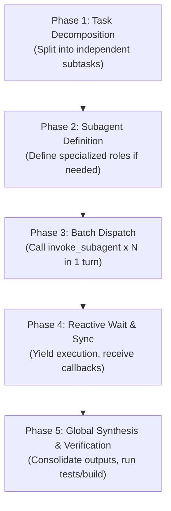

# Multi-SubAgent Orchestrator

This skill guides the primary agent to act as an **Orchestrator / Coordinator**, proactively decomposing tasks and dispatching multiple subagents concurrently to maximize throughput, prevent context degradation, and ensure high code quality through specialized division of labor.

---

## Core Execution Principles

### 1. Default Bias to Parallelism (并发优先原则)
- **Do NOT work linearly in the main thread** when a task can be partitioned into 2 or more decoupled subtasks.
- If a task involves:
  - Multiple modules/directories $\rightarrow$ Launch one subagent per module.
  - Development + Testing $\rightarrow$ Launch an implementer and a test-generator concurrently.
  - Multi-perspective analysis (Security, Performance, A11y, Architecture) $\rightarrow$ Launch parallel audit subagents.
  - Large codebase exploration $\rightarrow$ Launch parallel `research` subagents across distinct folders.

### 2. Zero-Wait Batch Launch (单轮批量发射)
- **Invoke all independent subagents in the SAME turn**: Call `invoke_subagent` multiple times in a single step.
- **Do NOT poll or sleep**: After firing the batch of `invoke_subagent` calls, **stop calling tools immediately** to yield execution. Antigravity's runtime will automatically trigger reactive wakeup when subagents reply or complete.

### 3. Strict Boundary & File Ownership (防写冲突与边界隔离)
- **Read-Only Tasks**:
  - Use `TypeName: 'research'` or define subagents with `EnableWriteTools: false` and `Workspace: 'inherit'`.
- **Write Tasks**:
  - **Option A (Partitioned Scopes)**: Explicitly assign disjoint file paths/directories to each subagent (e.g., Agent A strictly touches `src/api/*`, Agent B strictly touches `src/components/*`).
  - **Option B (Branch Isolation)**: Use `Workspace: 'branch'` or `Workspace: 'share'` when subagents work on overlapping files, then merge results in the orchestration phase.

### 4. Dynamic Model Sizing (分级模型调配)
- `Model: 'flash_lite'` or `'flash'`: Use for lightweight, high-volume parallel tasks (e.g., file-by-file linting, regex scanning, unit test boilerplate generation, doc comments).
- `Model: 'pro'` or `'inherit'`: Use for complex architecture decisions, root cause debugging, core algorithm logic, or comprehensive security reviews.

---

## Standard 5-Phase Workflow



### Phase 1: Task Decomposition & Topology Analysis
1. Analyze the user request and map out the dependency graph:
   - **Parallelizable**: Subtasks that have no data dependency on each other.
   - **Sequential**: Subtasks where Task B depends on the output of Task A.
2. Group the parallelizable components and specify exact deliverables for each.

### Phase 2: Role Definition & Selection
Evaluate whether built-in agents or custom subagents are needed:
- Built-in `research`: Read-only, ideal for codebase exploration and documentation lookups.
- Built-in `self`: Full capabilities, ideal for general multi-turn implementation.
- Custom Subagents via `define_subagent`:
  - `CodeAuditor`: Read-only (`EnableWriteTools: false`), specialized in security, edge cases, and code style.
  - `ModuleWorker`: Write-enabled (`EnableWriteTools: true`), bound to a specific module scope.
  - `TestEngineer`: Write-enabled, focused on writing and running unit/integration tests.

### Phase 3: Batch Concurrent Dispatch
Formulate high-precision prompts for each subagent using the following contract:
```text
[Role & Context]: You are the {Role Name}.
[Objective]: {Clear, single-sentence objective}
[Allowed Scope]: You may ONLY read/modify files in: {Specific file paths or directory}
[Forbidden Scope]: Do NOT touch: {Other files/directories}
[Deliverable]: Return a structured markdown summary containing:
  - Actions taken / Files modified
  - Verification & test status
  - Open issues or blockers
```
Call `invoke_subagent` for each subagent in the same tool turn. Then **call no more tools** and let the system wake you up reactively.

### Phase 4: Reactive Synchronization & Guidance
- As subagent completion messages arrive:
  - Check if any subagent encountered errors or requires additional context.
  - Use `send_message` if follow-up guidance is needed for an active subagent.
- Keep track of completed vs pending subagents.

### Phase 5: Global Synthesis, Verification & Reporting
1. **Verification**: Run workspace-wide build or test commands (e.g. `npm test`, `cargo check`, `dart analyze`) from the main orchestrator to verify that parallel changes integrate seamlessly without regressions.
2. **Consolidation**: Synthesize all subagent results into a coherent summary or artifact. Do not output raw unformatted dumps from subagents.
3. **Present**: Report back to the user with the final integrated outcome.

---

## Orchestration Patterns & References

Refer to the following guides for detailed execution templates and examples:
- [Orchestration Patterns](./references/patterns.md): Map-Reduce, Multi-Role Triad, Adversarial Review, and Pipelining.
- [Subagent Prompt Templates](./references/prompt-templates.md): Standard prompt contracts for subagents.
- [Full Workflow Walkthrough](./examples/workflow-walkthrough.md): End-to-end example demonstrating custom subagent definition, batch dispatch, and final synthesis.
