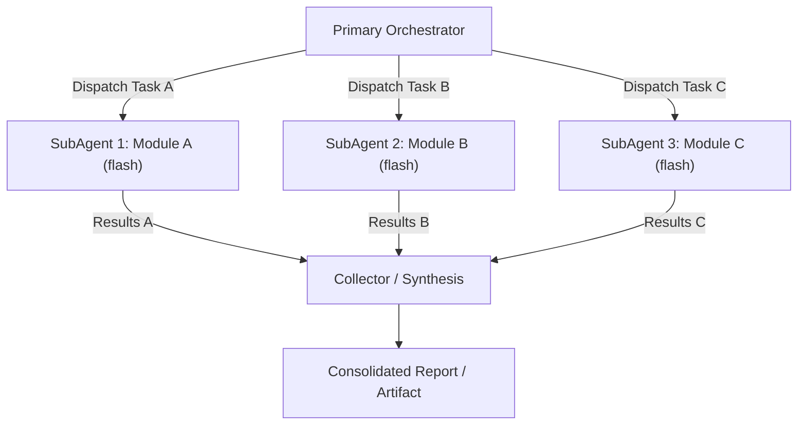
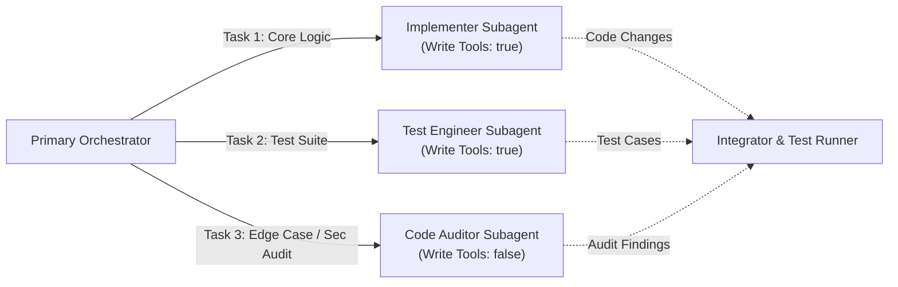
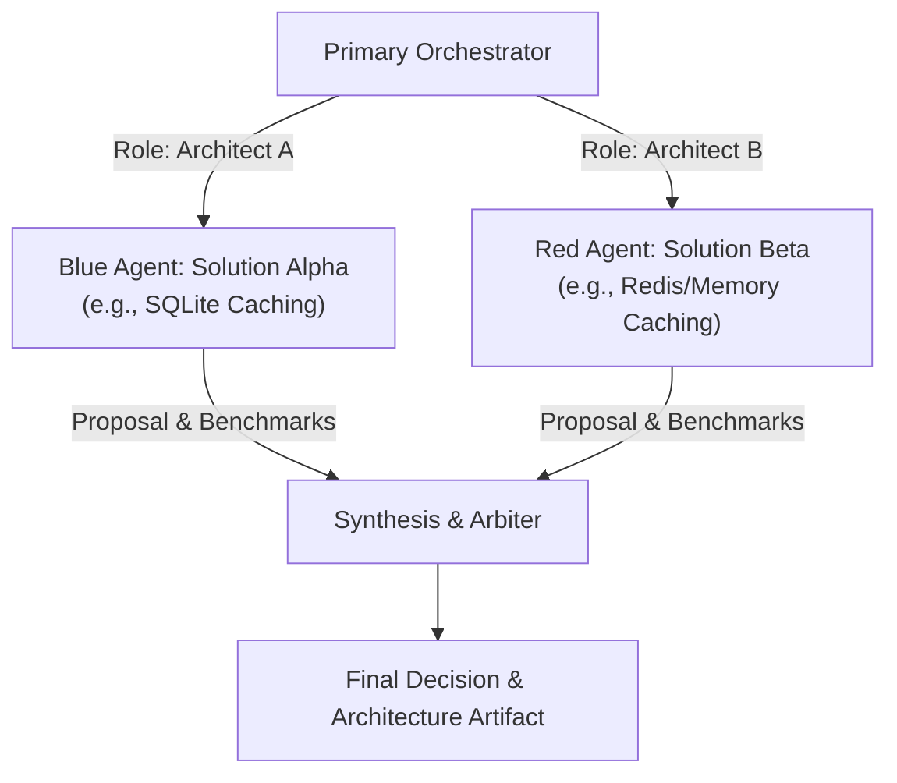
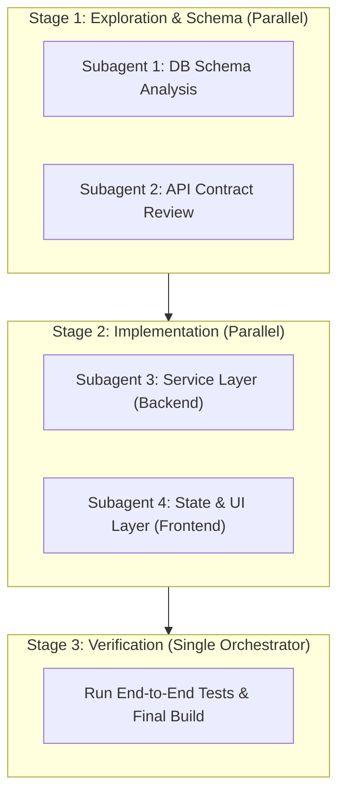

# SubAgent Orchestration Patterns

This document details common multi-subagent orchestration patterns, their structural topology, and when to apply them.

---

## Pattern 1: Map-Reduce (Fan-Out / Fan-In)

Use this pattern when a task can be divided into $N$ mutually exclusive slices across files, directories, or endpoints.

### Ideal Scenarios
- **Large-scale Codebase Audit**: Auditing security, performance, or styling across different sub-packages.
- **Batch Refactoring / Migration**: Migrating deprecated API calls across multiple directories.
- **Bulk Documentation / Unit Testing**: Generating missing unit tests or doc comments across independent classes.

### Best Practices
- **Model Selection**: Usually `Model: 'flash'` or `'flash_lite'` is sufficient and cost-effective.
- **Scope Partitioning**: Give each subagent explicit boundaries (e.g. Subagent 1 only reads `lib/src/auth/`, Subagent 2 only reads `lib/src/network/`).
- **Batch Dispatch**: Send all `invoke_subagent` calls in turn 1, then halt tool execution until reactive notifications arrive.

---

## Pattern 2: The Multi-Role Triad (Implementer + Tester + Auditor)

Use this pattern for feature development, bug fixes, or mission-critical modifications where quality and verification cannot be compromised.

### Ideal Scenarios
- Complex feature implementation requiring simultaneous unit test scaffolding.
- Fixing subtle production bugs where regression prevention and security audits are critical.

### Best Practices
- The **Auditor** should have `EnableWriteTools: false` to ensure it only observes and critiques without modifying code.
- The **Implementer** should be constrained to production code (e.g. `src/features/foo/`).
- The **Tester** should be constrained to test directories (e.g. `tests/features/foo_test.ts`).
- Orchestrator runs the test suite once both Implementer and Tester complete.

---

## Pattern 3: Adversarial / Red-Blue Cross-Validation

Use this pattern when deciding on architecture, designing critical schemas, or evaluating trade-offs between competing technical solutions.

### Ideal Scenarios
- Complex database schema migration designs.
- Deciding state management libraries or concurrency architectures.
- High-stakes security review where one subagent looks for vulnerabilities (penetration analysis) and another verifies defenses.

### Best Practices
- Use `Model: 'pro'` or `'inherit'` for in-depth reasoning and structural analysis.
- Give each subagent identical business context and performance criteria.

---

## Pattern 4: Staged Pipeline with Stage Concurrence

Use this pattern when tasks have sequential stages, but within each stage, multiple subtasks can run in parallel.

### Execution Rules
1. Launch `A1` and `A2` concurrently in a single turn.
2. Wait for Stage 1 subagents to complete and consolidate their contracts.
3. Launch `B1` and `B2` concurrently with the consolidated contracts.
4. In Stage 3, the orchestrator performs the final end-to-end integration test and reports to the user.
