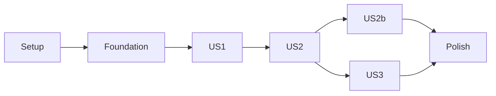

# Tasks: 004 播放解析与受控播放

**Input**: [spec.md](spec.md)、[plan.md](plan.md)、[research.md](research.md)、[data-model.md](data-model.md)、[contracts/api.md](contracts/api.md)、[quickstart.md](quickstart.md)。
**Status**: 2026-10-25 仅生成任务；全部未执行，spec/ADR仍Proposed。不得将调用tasks视为接受或实现授权。
**Tests**: 规格quickstart与宪章要求单元/契约、负向、真实HTTP/Network/浏览器及迁移恢复证据；每个测试任务先观察失败再实现。
**Format**: `- [ ] Tnnn [P?] [USn?] 描述与路径`；[US2b]保留规格原故事标识；[P]仅指同一阶段、依赖满足且文件不重叠的测试编写机会，不自动授权多代理执行。
**Paths**: 下列路径相对仓库根。新文件路径为拟实现位置；现有页面使用Devices.tsx，部署使用docker-compose.yml，不另造重复入口。

## Phase 1: Setup

**Purpose**: 无业务实现；后续执行首先完成接受与契约基线。

- [X] T001 记录维护者对 spec.md 与 docs/adr/0009-playback-delivery-conversion.md 的明确接受依据于 docs/specs/004-playback-resolver/plan.md；未接受不得自行改为 Accepted 或安装/实现；当前生成任务不等于接受。
- [X] T002 在 docs/specs/004-playback-resolver/evidence.md 建立 SC-001～009 空白证据台账，记录当前分支/HEAD/已有脏文件及基线 lint/typecheck/test/build/runtime 实际结果，不覆盖已有更改，不预填通过。
- [X] T003 将 docs/specs/004-playback-resolver/contracts/api.md 转为同目录 contracts/openapi.yaml（OpenAPI 3.1），完整定义控制/流/审计端点、DTO、错误、Cookie/Bearer+ticket、可空字段和请求预算；验证所有FR映射一致，契约新增决策先同步设计。
- [X] T004 在 apps/web/package.json、pnpm-lock.yaml 与 Dockerfile 锁定完整 hls.js 和 FFmpeg/ffprobe 版本/镜像特性，记录许可证、编码器、双架构支持于 docs/specs/004-playback-resolver/research.md；安装/锁文件写入串行，不引入特权容器。
- [X] T005 在 packages/shared/package.json 接入独立 playback-schema.d.ts 生成及构建复制，在 packages/shared/src/index.ts 独立导出；生成 packages/shared/src/playback-schema.d.ts，不覆盖既有三份schema，复验OpenAPI与类型。

**Checkpoint**: 本阶段任务完成且对应验证留证后再推进依赖阶段，不预填勾选。

## Phase 2: Foundational

**Purpose**: 阻塞全部用户故事；测试按 quickstart 要求先失败再实现。

- [X] T006 在 apps/server/test/contract/playback-migration.e2e-spec.ts 建立0004→0005、down/up及备份恢复失败测试：旧身份/PIN/策略/目录/EPG逐值不变、复合家庭FK拒绝、CHECK约束、恢复后旧ticket不可复活；只用临时DATA_DIR。
- [X] T007 在 apps/server/src/database/migrations/0005_playback/{up,down}.sql 和 apps/server/src/database/schema.ts 创建 playback_session/playback_ticket，逐字段执行 data-model.md 的 playback_session/playback_ticket 两节全部字段、nullable、枚举、CHECK、索引及FK；不修改0001～0004，仅跑T006中这两表的约束子集；四表完整迁移/恢复测试在T008完成后执行。
- [X] T008 在 apps/server/src/database/migrations/0005_playback/{up,down}.sql 和 apps/server/src/database/schema.ts 创建 playback_conversion/playback_failure_event，逐字段执行data-model.md 对应两节的全部约束；与T007串行，所有表显式household_id，不省略稳定复合FK；四表齐备后复跑T006完整迁移/恢复测试。
- [X] T009 扩展 apps/server/src/database/database.ts 与 apps/server/src/database/migrate.ts 的0005必需表/列就绪和迁移演练，缺失返回healthz 503；在 apps/server/test/contract/playback-readiness.e2e-spec.ts 覆盖缺表/缺列和原目录仍安全拒绝，不在只读请求临时补表。
- [X] T010 在 apps/server/test/unit/playback/config.spec.ts 先建配置/边界失败测试，再在 apps/server/src/config/playback-budgets.ts、env.schema.ts 和 apps/server/.env.example 定义转换1～8默认1、软件线程1～8默认2、票60～900秒默认300、probe并发2/队列8/10秒/输出1MiB、任务512MiB/全局2GiB/磁盘余量1GiB及research全部预算，非法值启动拒绝。
- [X] T011 在 apps/server/src/modules/playback/playback.types.ts 与 playback.repository.ts 实现状态机/短事务CAS、原子全局reserved～stopping计额、输入不可变和失败补偿；写 apps/server/test/unit/playback/repository.spec.ts 先证明终态不复活、并发不超额、spawn失败释放，绝不跨probe/spawn持SQLite事务。
- [X] T012 在 packages/shared/src/constants.ts、apps/server/src/common/domain-error.ts、problem-json.filter.ts 接入契约稳定错误与流前/流后错误边界，响应no-store/referrer-policy；在 apps/server/test/unit/playback/redaction.spec.ts 先验证URL/路径/query ticket/FFmpeg stderr脱敏，不影响原错误。
- [X] T013 创建 apps/server/src/modules/playback/playback.module.ts，注册到 apps/server/src/app.module.ts，提供内部可信会话/资源依赖装配及临时测试夹具 apps/server/test/fixtures/playback/；不暴露测试路由，不替代现有SessionGuard/策略核心。

**Checkpoint**: 本阶段任务完成且对应验证留证后再推进依赖阶段，不预填勾选。

## Phase 3: US1 — 观看者发起受控播放 (P1)

**Independent Test**: 独立验收：受控HLS与NAS MP4起播、15分钟跨两次续期；四种处理路径、seek、字幕/音轨、资源不足与回收可运行验证。进入公开可用必须同时通过US2。

- [X] T014 [P] [US1] 在 apps/server/test/contract/playback-control.e2e-spec.ts 先覆盖 resolve/get/renew/heartbeat/stop/selection/seek 的请求字段、201/200/204、CAS、非法轨道/position/未知字段、终态、续期复用session而主动重播新session；加入preparing空字段/ready取票、seek状态转换/暂停意图、renew与seek交错事务及旧operationEpoch响应丢弃场景（服务端交错在此测试，浏览器丢弃由T053～T055验证）。
- [X] T015 [P] [US1] 在 apps/server/test/unit/playback/hls-proxy.spec.ts 与 apps/server/test/contract/playback-stream.e2e-spec.ts 先覆盖多变体、rendition/MAP/key/byte-range、Range/HEAD/416、畸形/循环/DRM/未知URI拒绝和流后中断，禁透传原始清单。
- [X] T016 [P] [US1] 在 apps/server/test/unit/playback/conversion.spec.ts 先覆盖probe、格式优先级、一次软件回退、配额、超时/速度、磁盘上限、generation、取消和回收的失败矩阵；时钟/进程夹具与真实FFmpeg测试明确分层。
- [X] T017 [US1] 在 apps/server/src/modules/playback/playback-authorization.service.ts 建立内部授权管线：SessionGuard可信会话、实时设备/档案/PIN、authorizeCurrentProfile、家庭可用资源；异步后提交前重验，US2补全负向；禁止临时放开鉴权。
- [X] T018 [US1] 在 apps/server/src/modules/playback/playback-ticket.service.ts 实现256-bit opaque票/hash存储、TTL、原设备Cookie/Bearer+绑定profile/session/generation、首次ready后以expectedGeneration申请票，此后提前60秒续期；签发事务CAS失败409不写票，preparing拒绝签票；续期不创建session/转换，旧票原TTL且换代后立即拒绝。
- [X] T019 [US1] 在 apps/server/src/modules/playback/playback-resolver.service.ts 实现可用资源稳定选择及preparing session（source/delivery可空），按data-model.md处理成本→source_id→playback_source_id排序，无priority字段；在 apps/server/test/unit/playback/resource-selection.spec.ts 先验证多源成本/稳定ID/失败候选/总期限排序；源失效下次解析切换；授权拒绝不建session、解析响应不等待完整probe，GET状态不泄漏源ID/位置；probe结束进ready，首次交付进playing，ready前无票；异步失败只更新session。
- [X] T020 [US1] 在 apps/server/src/modules/playback/nas-reader.ts 实现只读安全文件描述符输入、root/路径/符号链接/size/mtime校验及单Range/HEAD/backpressure；源变化停止旧session，数GB任意区间不整片读取，未发header返回problem、已发送则关闭流。
- [X] T021 [US1] 在 apps/server/src/modules/playback/hls-proxy.service.ts 实现应用层安全流式HTTP：每次DNS/redirect验证精确LAN许可，嵌套<=4/清单2MiB/10000URI/redirect3/首字节与空闲15秒/片64MiB/key16字节；不向上游转发应用Cookie/Bearer，不透传Location/Set-Cookie，断开取消读取。
- [X] T022 [US1] 在 apps/server/src/modules/playback/playback-assets.service.ts 实现(household,session,generation,assetId)映射，重写全部清单/segment/key/MAP/媒体轨URI；仅保留120秒窗口与仍使用引用，重启失效、TTL不超session、资产超限失败，禁止接受任意URL/路径参数。
- [X] T023 [US1] 在 apps/server/src/modules/playback/media-probe.service.ts 实现ffprobe受限子进程：shell=false、验证FD、禁网络/外部引用、10秒/1MiB及独立信号量；最多32音轨/字幕轨；输出可信codec/bitdepth/SDR/duration/服务器轨道ID，不缓存已变化输入。
- [X] T024 [US1] 在 apps/server/src/modules/playback/playback-plan.service.ts 实现direct→remux→audio_transcode→video_transcode；FR-014全部合法容器/编码组合选必要转换，H.264 8bit yuv420p/AAC输出、无4K/HDR转换或自动降分辨率，全部不可用稳定失败。
- [X] T025 [US1] 在 apps/server/src/modules/playback/conversion-supervisor.service.ts 实现原子reserve、参数数组启动和FFmpeg进度读取，硬件运行探测优先、失败最多软件回退一次且共用原期限；转封装和转码共用额度，直接播放不占额，满额立即忙不排队，退出确认后才释放。
- [X] T026 [US1] 在 apps/server/src/modules/playback/conversion-storage.service.ts 实现私有 household/session/generation 滚动HLS：4秒分片、120秒窗口、任务512MiB/全局2GiB/余量1GiB限额；暂停有界预取/节流、逐步删除，清理失败仍计预算并每60秒重试，不公开静态产物。
- [X] T027 [US1] 在 apps/server/src/modules/playback/conversion-watchdog.service.ts 实现首帧30秒/seek15秒、无正常等待时15秒无输出终止；每10秒计算30秒窗口，连续3次速度<1且buffer<8秒则性能不足；排除正常暂停/节流，SIGTERM后5秒强杀，禁止无限缓冲。
- [X] T028 [US1] 在 apps/server/src/modules/playback/playback-lifecycle.service.ts 实现15秒心跳、45秒失联、每15秒后台权限复核、stop/cancel/失败/失权终止及退出后60秒清理；启动先标interrupted/扫私有根再接转换，不按旧PID杀进程；关闭hook处理子进程并保留目录可用。
- [X] T029 [US1] 在 apps/server/src/modules/playback/playback-selection.service.ts 实现selection/seek版本CAS与单槽串行generation替换，保留session/逻辑位置；ready/playing/paused→preparing，保留desiredPaused、旧票失效，ready后renew取票；纯字幕只增version，返回duration/timelineOffset/presentationStart，处理关键帧前区间，直播seek400、旧代409，不瞬时双占额度。
- [X] T030 [US1] 在 apps/server/src/modules/playback/playback-subtitles.service.ts 实现内嵌SubRip/WebVTT与同stem .srt/.vtt旁车<=5MiB、只读根内无符号链接、SRT→VTT文本安全显示；默认音轨/字幕关闭，允许合法音轨选择，无ASS/图片/烧录，字幕逐请求授权。
- [X] T031 [US1] 在 apps/server/src/modules/playback/playback.controller.ts 与 playback-stream.controller.ts 接线全部控制和GET/HEAD资产端点，授权顺序一致、同源/CSRF、16KiB体限制、resolve/seek/selection每设备30次/分钟与renew10次/分钟、429 Retry-After；媒体不套控制频率。
- [X] T032 [US1] 在 apps/server/test/fixtures/playback/generate-media.mjs 与 manifest.json 建立可复现自制媒体/受控HLS样本，覆盖5容器、H.264/HEVC8/10bit/MPEG-4、AAC/AC3/EAC3/DTS四路径及非法/4K/HDR；记录生成参数与hash，不提交真实源凭据。
- [X] T033 [US1] 在 apps/server/test/runtime-smoke.mjs 扩展独立004真实HTTP场景：起播字节、续期同session/任务、Range/seek/换轨、额度满、限时失败/取消、失联/重启及字幕；使用独立临时库和媒体，不以mock子进程替代真实转换证据。
- [X] T034 [US1] 在 docs/specs/004-playback-resolver/evidence.md 回填US1后端独立checkpoint：T014～T016后端用例失败后通过；operationEpoch浏览器用例在T053～T055完成、真实FFmpeg四路径与HTTP结果；浏览器成功率/连续播放留待US3/T055，不因HTTP通过标SC-001/007完成。

**Checkpoint**: 本阶段任务完成且对应验证留证后再推进依赖阶段，不预填勾选。

## Phase 4: US2 — 服务端授权与负向拒绝矩阵 (P1)

**Independent Test**: 独立验收：每类控制与媒体资产完成身份/家庭/策略/重放/变化矩阵，不泄漏位置或存在性；可用API直接验证，无需UI。

- [X] T035 [P] [US2] 在 apps/server/test/contract/playback-authorization.e2e-spec.ts 先覆盖无/过期/撤销会话、未选/停用/PIN档案、儿童等级/未评级/黑白名单、跨家庭/无源统一404、复制票到其他设备/session/generation及异步提交授权变化。
- [X] T036 [P] [US2] 在 apps/server/test/unit/playback/input-security.spec.ts 先覆盖DNS重绑定/redirect、嵌套清单URI及凭据、NAS/字幕越界与符号链接、malformed probe、脚本、轨道伪造和header后错误脱敏；请求上游不能携带应用认证。
- [X] T037 [US2] 完善 apps/server/src/modules/playback/playback-authorization.service.ts 与 playback-ticket.service.ts，所有控制/清单/片/key/MAP/字幕/Range/HEAD读最新会话/profile/策略/源并核对票绑定；不缓存授权正结果，不把能力声明当权限。
- [X] T038 [US2] 完善 apps/server/src/modules/playback/playback.controller.ts、playback-stream.controller.ts 与 playback-lifecycle.service.ts 的并发变化失败关闭；当前档案变化下一请求拒绝，后台停止转换；解析源刚禁用无部分成功，按T035矩阵回归。
- [X] T039 [US2] 在 apps/server/test/runtime-smoke.mjs 追加US2真实HTTP矩阵：分别在清单/分片/key/MAP/字幕/Range/HEAD请求间切档案/收紧策略/注销/停源，下一请求拒绝；旧缓冲不计停止期限，流中失败不能注入JSON。
- [X] T040 [US2] 在 apps/server/test/contract/playback-authorization.e2e-spec.ts 验证新旧会话/票及nonce不能跨家庭枚举、GET状态/stop幂等不放开目标归属，扫DTO/header/日志无源URL/路径/原stderr/query ticket；修复后重新跑US1契约。
- [X] T041 [US2] 在 docs/specs/004-playback-resolver/evidence.md 回填SC-002/003/005后端负向证据及矩阵，明确浏览器层尚待验收；任何授权漏口阻塞MVP。

**Checkpoint**: 本阶段任务完成且对应验证留证后再推进依赖阶段，不预填勾选。

## Phase 5: US2b — 播放记录与失败可见性 (P2)

**Independent Test**: 独立验收：有效设备失败事件与成功session分离、字段齐全；无效会话不进入设备记录；家长能按设备查询且越权拒绝。

- [X] T042 [P] [US2b] 在 apps/server/test/contract/playback-records.e2e-spec.ts 先覆盖成功/失败/停止记录、不可见media_id=null、无效会话仅安全日志、owner当次密码/锁定/撤销/跨家庭、游标limit20/100及重复stop不重复结束事件。
- [X] T043 [US2b] 在 apps/server/src/modules/playback/playback-audit.service.ts 接入有效会话解析拒绝failure_event，成功session首次交付started_at/结束或失败时间；不可见标识不落库、不存客户端原ID，不复制ticket/位置/凭据到记录。
- [X] T044 [US2b] 在 apps/server/src/modules/playback/playback-records.controller.ts 实现POST设备记录查询：owner+当次密码、验证后重验session/家庭，按时间/id分页、仅脱敏字段、no-store；保留普通GET播放状态仅原设备+当前档案。
- [X] T045 [US2b] 在 apps/server/src/modules/playback/playback-retention.service.ts 实现每日清理30天审计、过期票24小时内清理，活跃session/转换不删、FK父级RESTRICT不误删媒体身份；在 apps/server/test/unit/playback/retention.spec.ts 先验证边界。
- [X] T046 [US2b] 在 apps/web/src/components/playback/DevicePlaybackRecords.tsx、apps/web/src/lib/api.ts 与 apps/web/src/pages/Devices.tsx 现有设备页接入最小记录入口；在本任务内先完成记录查询API类型与调用，不等待T049，复用家长验证，失败清密码、不显示源信息。
- [X] T047 [US2b] 在 apps/server/test/runtime-smoke.mjs 与 docs/specs/004-playback-resolver/evidence.md 回填SC-004真实HTTP及家长设备记录浏览器结果，记录字段完整率100%、未认证不入设备记录和权限负向。

**Checkpoint**: 本阶段任务完成且对应验证留证后再推进依赖阶段，不预填勾选。

## Phase 6: US3 — 详情页播放入口与播放器 (P2)

**Independent Test**: 独立验收：允许内容显示可用入口并起播，被禁同形404；准备/失败可理解，字幕音轨可选，切档案不被旧请求覆盖。

- [X] T048 [P] [US3] 在 docs/specs/004-playback-resolver/quickstart.md 建立可重复的失败浏览器场景清单：详情入口、被禁404、准备取消/超时、重试、档案切换、续期和seek；先记录未实现失败，实施后同场景重跑，不以静态截图代替Network。
- [X] T049 [US3] 在 apps/web/src/lib/api.ts 接入全部播放控制/记录契约类型和稳定错误映射，renew/seek/selection保留session/generation，拒绝把服务端授权事实交给客户端；仅补US3调用，记录查询类型及函数已在T046实现，不重复；与T046串行编辑。
- [X] T050 [US3] 在 apps/web/src/components/playback/MediaPlayer.tsx 实现原生HLS/MSE完整hls.js与MP4，逐请求当前ticket、到期前60秒renew复用播放，Safari轮换入口恢复逻辑位置；播放失败停止/轮询原因，不无限重试，不存ticket到localStorage。
- [X] T051 [US3] 在 apps/web/src/components/playback/PlaybackControls.tsx 实现完整影片逻辑进度条、seek offset/目标前画面跳过、字幕关闭/选择与音轨切换、准备/忙/超时/资源不足提示、取消重试，直播无seek；键盘可达，焦点及状态朗读可用。
- [X] T052 [US3] 在 apps/web/src/pages/MediaDetail.tsx 接入播放按钮和播放器，保留原目录/EPG，档案/id变化销毁播放器并丢弃旧代次；只对当前可见可用媒体开放入口，服务端404不显示策略细节。
- [X] T053 [US3] 在 apps/web/src/components/playback/usePlaybackSession.ts 实现15秒心跳（暂停继续）、stop/cancel/unmount发送及本地资源释放、selection/seek/renew竞态按session/generation及operationEpoch守卫（发送seek/换轨前递增epoch，旧请求即便返回新generation也丢弃）；停止成功或失权后旧响应不能复活播放。
- [X] T054 [US3] 在 docs/specs/004-playback-resolver/evidence.md 记录Chromium/Firefox/Safari真实服务+Network完整链路，HLS与MP4各20次>=19成功、解析P95<=1s、各15分钟跨两次续期、不重置位置；原生Safari不可仅以hls.js模拟代替。
- [X] T055 [US3] 在 docs/specs/004-playback-resolver/evidence.md 记录FR-014每必验样本有声有画15分钟、四路径、字幕/音轨/seek/轮换与安全负向，转换首帧<=30秒/seek<=15秒；缺设备或失败保留未验收，不减少样本范围。

**Checkpoint**: 本阶段任务完成且对应验证留证后再推进依赖阶段，不预填勾选。

## Phase 7: Polish & cross-cutting validation

**Purpose**: 全部故事通过后才最终验收；本轮不执行。

- [X] T056 在 docs/specs/004-playback-resolver/evidence.md 按quickstart独立临时库执行0005 up/down/up及一致备份恢复，校验原数据逐值不变、integrity_check/foreign_key_check及恢复票不复活，不对用户库运行down/drill。
- [X] T057 在 Dockerfile、docker-compose.yml 现有部署配置和 docs/specs/004-playback-resolver/quickstart.md 落实非root只读NAS、私有缓存、显式硬件映射与cgroup限制，补linux/amd64及arm64镜像启动/迁移/缺列503/缺FFmpeg能力失败证据。
- [X] T058 在 docs/specs/004-playback-resolver/evidence.md 单独记录真实Linux硬件加速及无硬件软件回退、4CPU/4GiB基线、线程/CPU/RSS/磁盘与并发1/2；验证30秒/15秒、速度看门狗、停止/45秒失联/退出60秒清理/重启及删除失败重试；仿真不作为硬件证明。
- [X] T059 在 docs/specs/004-playback-resolver/evidence.md 运行全仓gen:types/lint/typecheck/test/build/test:runtime，核对003目录/名单/EPG场景未删且保持通过，记录实际新增数字，不借历史456用例宣称004通过。
- [X] T060 在 docs/specs/004-playback-resolver/spec.md、plan.md、checklists/requirements.md、evidence.md 与 docs/adr/0009-playback-delivery-conversion.md 核对FR-001～019和SC-001～009证据完整，只有全部必需层级通过才标Verified，环境缺口如实保留。
- [X] T061 同步 README.md、docs/roadmap.md 与 docs/specs/004-playback-resolver/quickstart.md 的部署依赖/兼容范围/资源配置/迁移恢复/已知限制；记录停止迁移顺序与许可信息，保持同一变更中设计、契约、实现、证据一致。

**Checkpoint**: 本阶段任务完成且对应验证留证后再推进依赖阶段，不预填勾选。

## Dependencies & Execution Order

T001接受门禁→T002基线→T003契约→T004依赖→T005生成类型；所有安装/锁文件/类型生成串行。Foundation T006先失败→T007→T008→T009；T010～T013按顺序完成。US1测试T014/T015/T016可并行编写，确认失败后T017～T033按依赖顺序实现，T034后端checkpoint。授权从T017就必须存在，不得等US2才加锁；US2是完整矩阵和竞态强化，T035/T036先失败后T037～T041。US2b T042先失败→T043～T047；US3 T048先记录失败→T049～T055。US2b/US3默认串行，特别是api.ts、runtime-smoke、evidence.md不能同时写。Polish T056～T061按顺序完成。

所有模型/迁移/schema、shared类型、控制器/模块、现有错误映射和运行时脚本在同一工作区串行。路径不同不代表没有语义依赖；未完成依赖不允许凭[P]越过门禁。

## Parallel Examples by Story

- US1：Foundation完成后，同时编写T014控制契约、T015流/HLS契约、T016转换单测；不同时修改共享fixtures或运行依赖安装。
- US2：US1 checkpoint后，同时编写T035授权矩阵与T036输入安全测试；实现T037/T038串行。
- US2b：只读核对T042失败样例与T046设备UI需求可分开准备；没有可安全并行的业务写任务，按T042→T047串行。
- US3：T048失败浏览器场景准备可与独立的API契约只读核对并行；T049～T053具有共享播放器状态依赖，按顺序写；Chromium/Firefox/Safari实测可分环境执行，evidence.md统一串行回填。

## 模型约束权威引用

[data-model.md](data-model.md)为字段、nullable、枚举、CHECK、索引、复合FK和状态机的唯一权威。T007执行playback_session/playback_ticket节全部字段，T008执行playback_conversion/playback_failure_event节全部字段；T011及T017～T030执行运行时值对象、验证与恢复、资源排序规则。约束变动只更新权威模型与对应契约/测试，不在任务中维护副本。迁移测试逐字段断言，不能仅凭表存在判通过。

## Coverage & independent acceptance

| 故事/标准 | 任务及证据 |
|---|---|
| US1 / FR-001/004/005/008/012～019 | T014～T034，T048～T055补真实观看出口；T058硬件与资源实测 |
| US2 / FR-002/003/006/011 | T017基础授权，T035～T041全矩阵，T054/055浏览器负向 |
| US2b / FR-007 | T042～T047，成功session与failure_event分离、家长查询 |
| US3 / FR-009/010 | T048～T055，入口/友好错误/连续播放 |
| SC-001/005 | T033/T040 HTTP，T054真实播放/Network |
| SC-002/003 | T035～T041，T054/055 |
| SC-004 | T042～T047 |
| SC-006 | T006～T009、T056/057/059 |
| SC-007 | T019～T032、T055/058 |
| SC-008 | T028/T030/T043/T046/T053/T055/T058 |
| SC-009 | T027/T033/T055/T058 |

## Implementation Strategy

安全MVP为Setup+Foundation+US1基础HLS/MP4交付+US2负向矩阵+US3最小播放出口，不能只演示无鉴权的US1接口。之后完成US1全部格式/转换/字幕/音轨及回收，再补US2b家长记录与US3所有浏览器体验，最后全层验收。任务编号提供默认串行路线；若采用上述MVP裁剪只允许阶段性演示，未完成转换范围不能标004完成。每个故事独立checkpoint只声明它拥有的证据，不用HTTP替代浏览器，不以软件路径通过代替真实硬件证据。

本清单不执行接受、安装、迁移或实现。建议下一命令speckit-analyze进行跨文档一致性检查；实现前先完成T001。
