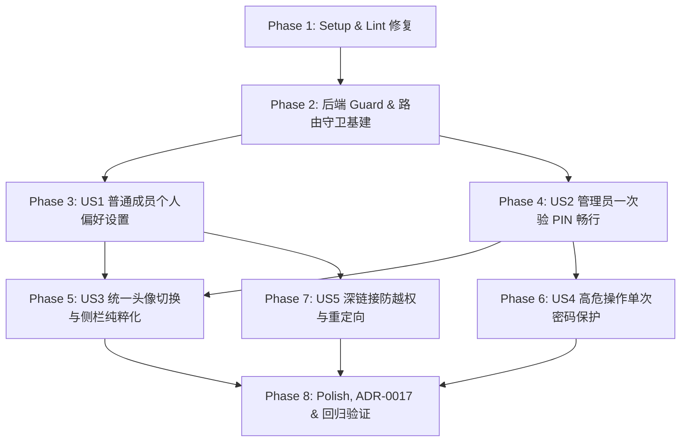

# Tasks: 角色差异化设置体系 (013-role-differentiated-settings)

**Input**: Design documents from `docs/specs/013-role-differentiated-settings/` (`spec.md`, `plan.md`, `research.md`, `data-model.md`, `contracts/`, `quickstart.md`)  
**Prerequisites**: `spec.md`, `plan.md`, `data-model.md`, `contracts/`  
**Constitution**: 严格遵循项目宪章核心原则：规格先行、三层身份边界不妥协、默认安全服务端鉴权、完整契约测试与负向越权测试。

## Format: `- [ ] [TaskID] [P?] [Story?] Description with file path`

- **[P]**: 可并行执行（不同文件，无未完成任务依赖）
- **[Story]**: 对应需求规格中的 User Story（[US1] ~ [US5]）

---

## Phase 1: Setup & Baseline Repair (Shared Infrastructure)

**Purpose**: 准备基础契约类型，并修复当前工作区阻断性 Lint 错误，建立干净基线。

- [X] T001 修复未完成的阻断性 Lint 错误与海报错误回落逻辑 in `apps/web/src/features/catalog/OnlineVodDetailPage.tsx`
- [X] T002 [P] 定义设置作用域类型（`SettingsScope`、`SettingsNavGroup`、`SettingsNavModule`）in `packages/shared/src/settings-schema.d.ts`
- [X] T003 [P] 定义个人偏好数据契约（`ProfilePreferences`，含默认语言、音轨、连播与主题）in `packages/shared/src/settings-schema.d.ts`

---

## Phase 2: Foundational (Blocking Prerequisites)

**Purpose**: 重构后端设置守卫（移除 15 分钟临时 Ticket 硬依赖）与前端设置全局上下文。

- [X] T004 编写后端 `SettingsGuard` 单元测试（验证基于 `activeProfile.isMain` 鉴权，且不再强制要求 `X-Settings-Grant-Token`）in `apps/server/test/unit/settings/settings-guard.spec.ts`
- [X] T005 重构后端 `SettingsGuard` 实现，直接读取 `session.activeProfile.isMain === 1` 放行主管理员 in `apps/server/src/contexts/settings/infrastructure/settings.guard.ts`
- [X] T006 [P] 精简前端 `SettingsAccessProvider`，去除 Ticket 轮询和复杂的客户端锁状态，直接透传当前会话的 `isMainProfile` in `apps/web/src/features/settings/settings-access-provider.tsx`
- [X] T007 [P] 创建前端深链接权限守卫组件 `AdminRouteGuard` in `apps/web/src/features/settings/components/AdminRouteGuard.tsx`

**Checkpoint**: 基础鉴权与上下文就绪，可以开始按用户故事并行推进各功能模块。

---

## Phase 3: User Story 1 - 普通成员直观且无干扰的“个人偏好”设置 (Priority: P1) 🎯 MVP

**Goal**: 普通成员点击设置时，侧栏仅呈现【个人设置】分组（播放体验、界面外观、我的档案），无家庭管理项，无锁提示，直接就地修改保存。

### Tests for User Story 1 (REQUIRED) ⚠️
- [X] T008 [P] [US1] 编写普通成员侧栏菜单过滤单元测试（断言仅展示个人偏好模块）in `apps/web/test/settings/settings-nav-filter.spec.ts`
- [X] T009 [P] [US1] 编写个人偏好保存契约测试（验证更新字幕/音轨/连播配置绑定 profile_id）in `apps/web/test/settings/personal-preferences.spec.tsx`

### Implementation for User Story 1
- [X] T010 [P] [US1] 重构设置模块清单定义 `settings-modules.tsx`，为各模块标注 `scope`，并实现 `getVisibleSettingsGroups(isMainProfile)` 过滤函数 in `apps/web/src/features/settings/settings-modules.tsx`
- [X] T011 [P] [US1] 实现个人播放体验设置组件（字幕语言、音轨偏好、自动连播下一集开关）in `apps/web/src/features/settings/settings-playback-page.tsx`
- [X] T012 [P] [US1] 实现个人外观偏好设置组件（深色/浅色/跟随系统模式）in `apps/web/src/features/settings/settings-appearance-page.tsx`
- [X] T013 [US1] 重构 `SettingsLayout.tsx` 侧栏渲染逻辑，对接 `getVisibleSettingsGroups`，使普通 Profile 仅渲染个人分组 in `apps/web/src/layouts/SettingsLayout.tsx`

**Checkpoint**: 普通成员进入设置只看到纯粹的个人偏好，且无需密码即可保存。

---

## Phase 4: User Story 2 - 管理员一次验 PIN 切换，畅行全部家庭管理 (Priority: P1)

**Goal**: 主管理员在头像菜单输入 1 次 PIN 切换后，设置页面平滑展开全量管理菜单，所有常规管理操作零弹窗二次索要 PIN。

### Tests for User Story 2 (REQUIRED) ⚠️
- [X] T014 [P] [US2] 编写管理员设置侧栏全量展示与常规操作零阻断测试 in `apps/web/test/settings/admin-seamless-settings.spec.tsx`
- [X] T015 [P] [US2] 编写后端常规管理接口免临时 Ticket 校验契约测试 in `apps/server/test/contract/settings-no-ticket.e2e-spec.ts`

### Implementation for User Story 2
- [X] T016 [US2] 移除所有子管理页面（媒体源、EPG、策略、设备）外层包裹的阻断性 `SettingsUnlockGate` in `apps/web/src/features/settings/settings-sources-page.tsx`、`apps/web/src/features/settings/settings-policy-page.tsx`、`apps/web/src/features/settings/settings-epg-page.tsx`
- [X] T017 [US2] 精简并改造 `settings-unlock-gate.tsx`，废止全屏遮罩门禁，仅保留必要时的轻量占位 in `apps/web/src/features/settings/settings-unlock-gate.tsx`
- [X] T018 [US2] 调整通用家庭管理页面 `settings-general-page.tsx`，移除对临时 Ticket 的读取，直接读取家庭时区与共享配置 in `apps/web/src/features/settings/settings-general-page.tsx`

**Checkpoint**: 管理员在切换身份后，可顺畅配置所有家庭管理项，不再反复跳出输入 PIN 框。

---

## Phase 5: User Story 3 - 统一头像切换与侧栏纯粹性 (Priority: P2)

**Goal**: 侧栏底部彻底移除任何“切换管理员”提示或按钮，全站身份切换唯一收敛于右上角头像菜单。

### Tests for User Story 3 (REQUIRED) ⚠️
- [x] T019 [P] [US3] 编写侧栏底部纯粹性 UI 断言测试（确保普通和管理员模式下底部均无多余按钮）in `apps/web/test/settings/settings-sidebar-clean.spec.tsx`

### Implementation for User Story 3
- [x] T020 [US3] 清理 `SettingsLayout.tsx` 侧栏底部现存的任何多余提权入口、锁标或状态提示 in `apps/web/src/layouts/SettingsLayout.tsx`
- [x] T021 [US3] 优化右上角头像菜单 `identity-menu.tsx`，确保在设置页面内切换 Profile 后就地触发页面重渲染并刷新设置侧栏 in `apps/web/src/features/profiles/identity-menu.tsx`

**Checkpoint**: 侧栏视觉彻底清爽，换人交互全站统一。

---

## Phase 6: User Story 4 - 针对高危资产破坏操作的单次密码底线防御 (Priority: P2)

**Goal**: 在修改管理员主账号密码、注销核心档案等不可逆高危动作时，弹出单次密码输入确认。

### Tests for User Story 4 (REQUIRED) ⚠️
- [x] T022 [P] [US4] 编写修改主账号密码时的单次密码确认前后端契约测试 in `apps/web/test/settings/sensitive-action-password.spec.tsx`

### Implementation for User Story 4
- [x] T023 [US4] 确保【账号与安全】页面在提交新密码时强制携带当前密码字段进行原子校验 in `apps/web/src/features/settings/settings-account-page.tsx`
- [x] T024 [US4] 确保注销或删除非活动 Profile 时弹出带有密码验证的破坏性操作确认弹窗 in `apps/web/src/features/settings/settings-profiles-page.tsx`

**Checkpoint**: 守住安全底线，防止非授权人员修改主密码。

---

## Phase 7: User Story 5 - 非法深链接防越权与优雅重定向 (Priority: P3)

**Goal**: 普通成员手动在地址栏输入管理路由时，前端路由守卫拦截并重定向，后端接口 403 严格拒绝。

### Tests for User Story 5 (REQUIRED) ⚠️
- [x] T025 [P] [US5] 编写普通成员深链接访问受限路由自动重定向至个人偏好测试 in `apps/web/test/settings/settings-deep-link-guard.spec.tsx`
- [x] T026 [P] [US5] 编写普通成员直调管理接口 403 负向测试 in `apps/server/test/contract/settings-guard-negative.e2e-spec.ts`

### Implementation for User Story 5
- [x] T027 [US5] 在前端路由配置中，使用 `AdminRouteGuard` 包裹全部管理子路由（`/settings/sources`、`/settings/policy`、`/settings/epg`、`/settings/devices`）in `apps/web/src/app/routes.tsx`
- [x] T028 [US5] 增强拦截反馈：当触发重定向时通过 Toast 呈现友好提示（“该功能需要主管理员身份”）in `apps/web/src/features/settings/components/AdminRouteGuard.tsx`

**Checkpoint**: 无论前端手动敲 URL 还是直接调 API，均具备严密的纵深安全防护。

---

## Phase 8: Polish & Governance Alignment

**Purpose**: 架构决策归档、全量测试回归与快速走查。

- [X] T029 [P] 新增 ADR-0017（《角色差异化设置体系与免套娃授权演进》），正式标记 ADR-0011 相关部分为 Superseded in `docs/adr/0017-role-differentiated-settings.md`
- [X] T030 运行全套单元测试与契约测试验证绿灯：`pnpm test`
- [X] T031 运行全套静态代码检查确保零 Warning/Error：`pnpm lint`
- [X] T032 执行 `quickstart.md` 中定义的 4 项关键验证场景走查并记录在 evidence 文档中 in `docs/specs/013-role-differentiated-settings/evidence.md`

---

## Dependencies & Execution Order

### 推荐 MVP 范围
- **MVP**: 完成 Phase 1、Phase 2 以及 **Phase 3 (User Story 1)**。
- 此时普通用户即可拥有干净、不撞锁的个人设置面板，实现核心用户体验飞跃。
