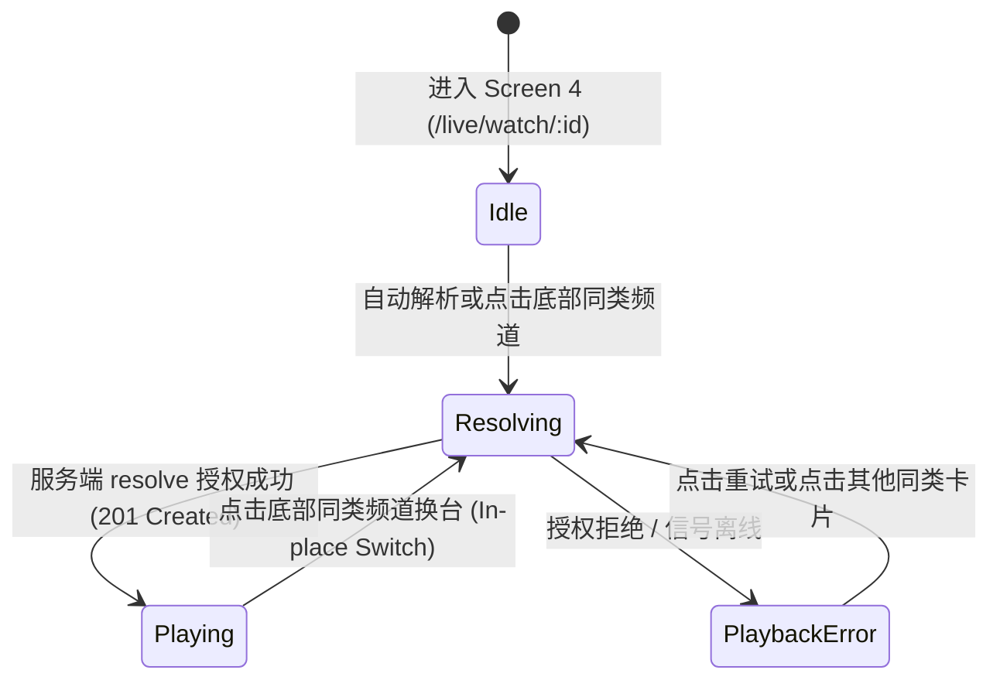
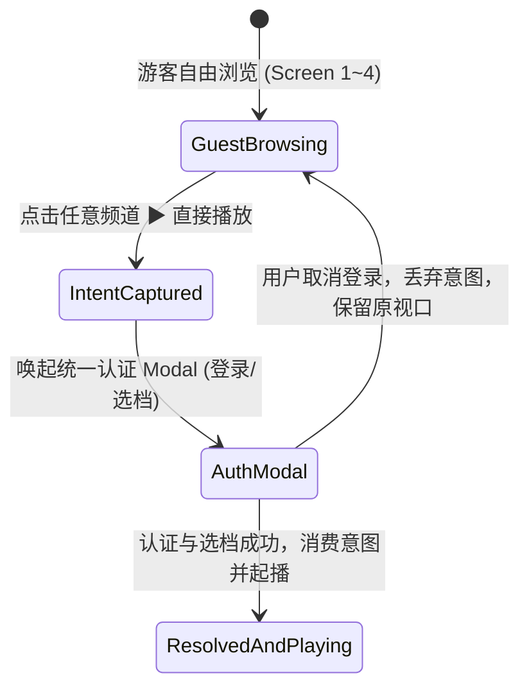

# Data Model: 直播全流程重构 (015-live-flow-redesign)

**Feature**: 直播全流程重构——即开即看、智能分流与同类切台
**Input**: [spec.md](spec.md)、[research.md](research.md)、手绘线框图与批注

---

## 1. 实体与模型（完全复用与前端扩展）

本功能为**纯前端体验与流转重构，零服务端持久化变更，零数据库迁移**。所有业务数据均由现有 `@hmp/shared` 契约与公共 API 支撑。

### 1.1 核心数据结构

```typescript
// 1. 频道基础投影 (ChannelRowDto - 已存在于 @hmp/shared)
export interface ChannelRowDto {
  readonly id: string;           // 媒体/频道唯一标识 (mediaId)
  readonly title: string;        // 频道名称 (如 "CCTV-1 综合")
  readonly groupTitle?: string;  // 来源分组 (如 "央视频道", "电影频道")
  readonly logoRef?: string | null; // 频道 Logo 不透明引用
  readonly currentProgramme?: ExperienceProgrammeDto | null; // 当前节目
  readonly nextProgramme?: ExperienceProgrammeDto | null;    // 下一档节目
}

// 2. 节目时段投影 (ExperienceProgrammeDto - 已存在于 @hmp/shared)
export interface ExperienceProgrammeDto {
  readonly id: string;
  readonly title: string;        // 节目标题 (如 "新闻联播")
  readonly description?: string | null; // 节目简介
  readonly startsAt: string;     // ISO 8601 起始时间
  readonly endsAt: string;       // ISO 8601 结束时间
}

// 3. 频道分类条目 (ChannelGroupItemDto)
export interface ChannelGroupItemDto {
  readonly key: string;          // 分组标识 (如 "movie", "sports", "cctv")
  readonly label: string;        // 显示名称 (如 "电影频道", "体育赛事")
  readonly count: number;        // 分组内频道数量
}
```

---

## 2. 前端聚合视图模型 (View Models)

为了驱动手稿中的 4 个核心页面，前端定义以下响应式视图模型：

### 2.1 Screen 1 (直播首页视图模型 `LiveHomeViewModel`)
```typescript
export interface LiveHomeViewModel {
  /** 顶部 Hero 大屏直接播放频道 (优先选择上次观看频道或 now 区排位首频道) */
  readonly heroChannel: ChannelRowDto | null;
  /** 正在直播泳道 (Now Section) */
  readonly nowChannels: readonly ChannelRowDto[];
  /** 即将播放预告泳道 (Next Section) */
  readonly nextChannels: readonly ChannelRowDto[];
  /** 展示各个分类的泳道列表 (多行，按分类平铺) */
  readonly categorySections: readonly {
    readonly groupKey: string;
    readonly groupLabel: string;
    readonly channels: readonly ChannelRowDto[];
  }[];
  /** 家庭时区与服务端时间快照 */
  readonly timezone: string;
  readonly serverNowIso: string | null;
}
```

### 2.2 Screen 2 (分类网格视图模型 `ChannelGridViewModel`)
```typescript
export interface ChannelGridViewModel {
  /** 当前激活的分类 Tab (对应 URL ?group=...) */
  readonly activeGroupKey: string;
  /** 全部可用分类 Tabs 清单 */
  readonly availableGroups: readonly ChannelGroupItemDto[];
  /** 当前分类下匹配当前搜索关键词 (q) 的频道列表 */
  readonly filteredChannels: readonly ChannelRowDto[];
  /** 当前关键词过滤状态 */
  readonly searchQuery: string;
}
```

### 2.3 Screen 4 (播放与详情一体化视图模型 `LiveWatchViewModel`)
```typescript
export interface LiveWatchViewModel {
  /** 当前正在播放的频道标识 */
  readonly activeChannelId: string;
  /** 当前频道的完整元数据 */
  readonly channel: ChannelRowDto | null;
  /** 当前节目播出进度 (0 ~ 100%) */
  readonly progressPercentage: number;
  /** 下一档节目预告 */
  readonly nextProgramme: ExperienceProgrammeDto | null;
  /** 同类型直播推荐频道列表 (sam type live) - 排除当前 activeChannelId */
  readonly sameTypeLiveChannels: readonly ChannelRowDto[];
  /** 频道收藏状态 */
  readonly isFavorite: boolean;
}
```

---

## 3. 状态转换机 (State Machine)

### 3.1 换台切流状态转移 (Screen 4 In-Place Channel Switch)



### 3.2 游客起播意图状态转移 (ActionCoordinator)


