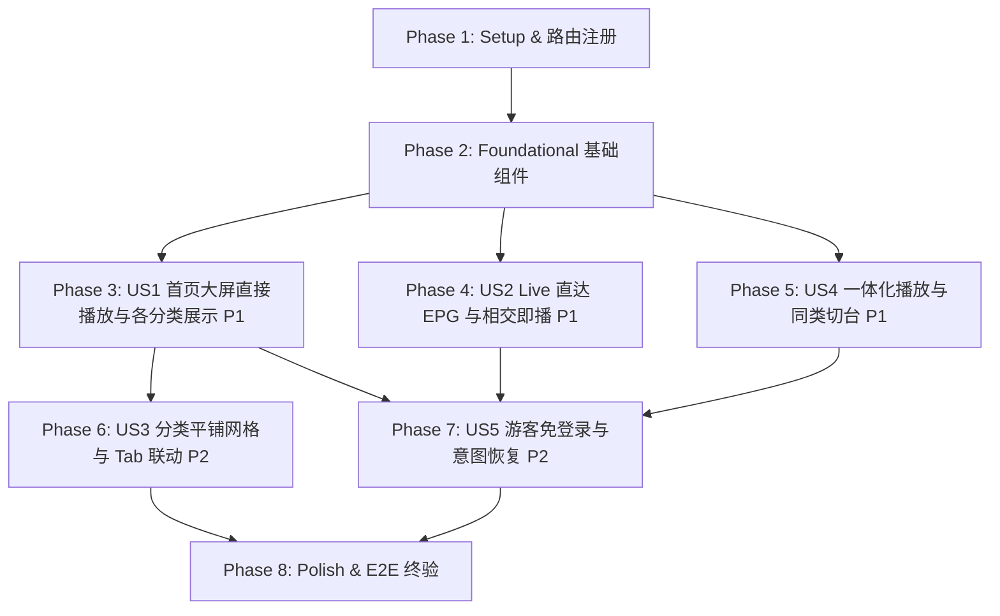

# Tasks: 直播全流程重构——即开即看、智能分流与同类切台 (015-live-flow-redesign)

**Input**: [spec.md](spec.md)、[plan.md](plan.md)、[research.md](research.md)、[data-model.md](data-model.md)、[contracts/](contracts/)、[quickstart.md](quickstart.md) 及用户手绘线框图
**Prerequisites**: plan.md (required), spec.md (required), research.md, data-model.md, contracts/
**Tests**: 项目宪章核心原则一要求多层测试证据（包含单元测试、端到端测试与人工走查）；所有任务均严格对照手绘线框图与批注执行。

## Format: `[ID] [P?] [Story] Description`
- **[P]**: 可并行执行（不同文件、无未完成依赖）
- **[Story]**: 对应规格中的用户故事（US1～US5）
- 每个任务必须包含明确的文件路径

---

## Phase 1: Setup & Routing Foundation (工程基线与路由准备)

**Purpose**: 准备测试基线并注册 Screen 1～4 的新路由通道

- [X] T001 记录现状基线：运行 `pnpm lint`、`pnpm typecheck` 以及 `pnpm --filter @hmp/web test` 确保当前基线全绿
- [X] T002 注册重构路由(执行注记:routes.tsx 为静态 import,两路由随 Screen 2/4 页面落地同步注册,避免中间态破坏 typecheck)：在 `apps/web/src/app/routes.tsx` 中注册 `/live/channels`（Screen 2 分类网格）与 `/live/watch/:channelId`（Screen 4 一体化播放页）路由入口

---

## Phase 2: Foundational (公共组件与数据支撑)

**Purpose**: 构建跨用户故事共用的基础组件与数据查询 Hook（阻塞后续故事）

- [X] T003 [P] 创建同类型直播数据查询 Hook：在 `apps/web/src/features/live/hooks/use-related-live-channels.ts` 中封装获取同组正在直播频道的查询逻辑（基于 `groupKey` 过滤并排除当前 `activeChannelId`）
- [X] T004 [P] 升级频道卡片 Hover 快捷起播组件：改造 `apps/web/src/features/live/components/channel-card.tsx`（或对应频道卡片），实现悬停平滑浮现强调色 `▶ 播放` 按钮，点击直接调用 `usePlayAction`，点击文字区域导航至详情
- [X] T005 [P] 扩充直播重构测试夹具：在 `apps/web/test/fixtures/live-redesign-fixtures.ts` 中补充包含多个分类组（如电影、音乐、体育）、当前播出节目、下一档预告及 NOW 时间戳的测试假数据

**Checkpoint**: 基础路由与通用卡片就绪，用户故事实施可并行展开。

---

## Phase 3: User Story 1 - 首页大屏直接播放与各个分类全景展示 (Priority: P1) 🎯 MVP

**Goal**: 完整实现手稿 Screen 1：顶部 Hero 实时直接播放大屏 + 正在直播泳道 + 即将播放预告 + 自上而下展示各个分类泳道

**Independent Test**: 打开 `/live`，顶部大屏即具备实时播放能力并静音起播；下方依次呈现正在直播、即将播放以及电影、音乐、体育等各个分类的频道泳道；卡片 Hover 点击直接起播。

### Tests for User Story 1 (REQUIRED) ⚠️
- [X] T006 [P] [US1] 顶部 Hero 直接播放组件单测：在 `apps/web/test/features/live/live-hero-player.spec.tsx` 中验证 `LiveHeroPlayer` 正确挂载实时播放器容器、提供静音切换按钮以及展开全屏/大屏入口
- [X] T007 [P] [US1] 卡片悬停直接起播单测：在 `apps/web/test/features/live/channel-card-hover-play.spec.tsx` 中验证鼠标悬停卡片浮现 `▶` 按钮，点击调用 `usePlayAction` 且不跳出静态二级详情

### Implementation for User Story 1
- [X] T008 [US1] 实现 Screen 1 顶部直接播放 Hero 播放器组件：创建 `apps/web/src/features/live/components/LiveHeroPlayer.tsx`，支持直接收看直播、静音开播与全屏展开（替代原有静态 NowHero）
- [X] T009 [US1] 实现【展示各个分类】逐行平铺泳道组件：创建 `apps/web/src/features/live/components/CategorySwimlanes.tsx`，将系统各个分组逐行横滑排布，行尾提供 `[全部XX频道 >]` 按钮
- [X] T010 [US1] 重构直播综合首页装配：在 `apps/web/src/features/live/LivePage.tsx` 中组合 `LiveHeroPlayer`、`NowSection`、`NextSection` 与 `CategorySwimlanes`，严格还原手绘 Screen 1 布局

**Checkpoint**: User Story 1 独立可运行并验收，直播首页实现直接收看与分类全景浏览。

---

## Phase 4: User Story 2 - Live 行直达 EPG 节目单时间墙与相交节目即时起播 (Priority: P1)

**Goal**: 实现手稿 Screen 1 到 Screen 3 的智能分流：正在直播行尾点击直达 EPG 时间墙，且相交于当前时间线的节目块直接起播

**Independent Test**: 在 Live 行尾点击“全部正在直播”，直接导航至 `/live/guide`，页面准确定位在当前时刻红线；点击相交的当前节目块直接发起播放；点击未来节目块弹出轻量详情抽屉。

### Tests for User Story 2 (REQUIRED) ⚠️
- [X] T011 [P] [US2] Live 直达 EPG 与相交节目起播单测：在 `apps/web/test/features/live/live-routing-epg.spec.tsx` 中验证 Live 行尾跳转目标为 `/live/guide`，且与 NOW 相交的节目块点击直接触发 `playChannel`

### Implementation for User Story 2
- [X] T012 [US2] 改造 Live 行尾查看全部入口：更新 `apps/web/src/features/live/components/NowSection.tsx`，将“查看全部”导航目标从原有局部聚焦改为直接跳转 `/live/guide`
- [X] T013 [US2] 打通 EPG 节目单时间墙当前节目点击起播：在 `apps/web/src/features/epg/GuideWall.tsx` 中检测相交于 NOW 线的节目块（`current` 态），点击直接调用 `usePlayAction` 起播，未来节目（`upcoming` 态）保留轻量抽屉展示

**Checkpoint**: User Story 1 与 User Story 2 均可独立验收，完成排期维度的全链路流转。

---

## Phase 5: User Story 4 - 播放与详情一体化页与同类型直播无缝切台 (Priority: P1)

**Goal**: 完整实现手稿 Screen 4：独立播放与详情一体化页，进入即自动起播，伴随展示当前节目详情与下档预告，底部 `sam type live` 支持无刷新就地换台

**Independent Test**: 访问 `/live/watch/:channelId`，左侧播放器自动起播；右侧展示当前节目进度、简介与下一档预告；底部展示同类直播横条；点击另一同类卡片，页面不重载，就地换流，地址栏静默更新。

### Tests for User Story 4 (REQUIRED) ⚠️
- [X] T014 [P] [US4] 一体化播放页与切台单测：在 `apps/web/test/features/live/live-watch-page.spec.tsx` 中验证页面加载自动解析起播、右侧元数据伴随渲染，以及点击同类卡片触发就地切流与 URL 同步

### Implementation for User Story 4
- [X] T015 [P] [US4] 实现同类型直播推荐横条组件：创建 `apps/web/src/features/live/components/SameTypeLiveStrip.tsx`，基于当前频道分类渲染横向滚动的同类在线频道卡片（`sam type live`）
- [X] T016 [US4] 实现 Screen 4 独立一体化播放与详情页面：创建 `apps/web/src/features/live/pages/LiveWatchPage.tsx`，左侧/上部大尺寸 VideoPlayer 容器（进入自动 resolve 起播），右侧当前节目进度条、简介、频道收藏与 Next 预告
- [X] T017 [US4] 实现无刷新平滑切台换流逻辑：在 `LiveWatchPage.tsx` 中整合 `useInPlaceChannelSwitch`，点击同类频道时仅更新播放会话与媒体流，调用 `navigate('/live/watch/:id', { replace: true })` 保持地址栏静默同步

**Checkpoint**: 核心播放与换台闭环交付，告别冷冰冰的二级图文详情。

---

## Phase 6: User Story 3 - 各分类查看全部进入分类网格与 Tab 联动检索 (Priority: P2)

**Goal**: 完整实现手稿 Screen 2：从分类行进入多列平铺分类网格大厅，分类 Tabs 自动激活对应类别，支持关键字搜索与卡片快捷起播

**Independent Test**: 从电影分类行点击“全部电影频道 >”，跳转至 `/live/channels?group=movie`；顶部分类 Tabs 中“电影”自动激活；主体展示响应式多列网格；搜索框可实时过滤。

### Tests for User Story 3 (REQUIRED) ⚠️
- [X] T018 [P] [US3] 分类网格与 Tab 联动单测：在 `apps/web/test/features/live/channel-grid-page.spec.tsx` 中验证读取 `?group=...` 参数自动选中 Tab、搜索框实时过滤频道，以及卡片点击播放行为

### Implementation for User Story 3
- [X] T019 [US3] 实现 Screen 2 分类平铺网格页面：创建 `apps/web/src/features/live/pages/ChannelGridPage.tsx`，顶部 HeroUI `Tabs`、搜索过滤框，主体渲染响应式多列频道卡片网格
- [X] T020 [US3] 联动分类行尾跳转入口：更新 `CategorySwimlanes.tsx` 中的行尾按钮，点击导航至 `/live/channels?group=${groupKey}`，打通 Screen 1 到 Screen 2 的流转

**Checkpoint**: 内容分类检索维度闭环完备。

---

## Phase 7: User Story 5 - 游客免登录浏览与播放意图全链路恢复 (Priority: P2)

**Goal**: 保证全站元数据游客免登录畅行，在任意播放入口点击播放时暂存意图，登录/选档完成后自动恢复起播

**Independent Test**: 无痕窗口访问直播，自由浏览 4 个页面；点击任意播放按钮唤起认证 Modal；登录选档完成后自动开始播放原目标；取消则停留在原视口。

### Tests for User Story 5 (REQUIRED) ⚠️
- [X] T021 [P] [US5] 游客意图恢复全链路单测：在 `apps/web/test/features/live/guest-intent-recovery.spec.tsx` 中模拟游客状态点击 Hero 播放、卡片播放、EPG 节目块播放，验证 `ActionCoordinator` 拦截、暂存意图并在完成选档后消费意图发起授权

### Implementation for User Story 5
- [X] T022 [US5] 接驳意图守卫至全部起播端点：在 `LiveHeroPlayer`、`ChannelCard`、`GuideWall` 以及 `LiveWatchPage` 中统一使用 `usePlayAction` 发起起播，确保游客状态下精准暂存当前 `mediaId` 并在认证后无损恢复

---

## Phase 8: Polish & Cross-Cutting Concerns (全量集成与验收)

**Purpose**: 跨页面体验打磨、响应式适配与端到端回归

- [X] T023 [P] 编写端到端走查测试：在 `apps/web/test/e2e/live-flow-redesign.spec.ts` 中覆盖 Screen 1 首页 → Screen 3 EPG → Screen 4 一体化播放 → 同类换台 → Screen 2 分类网格的完整用户旅程
- [X] T024 [P] 响应式视口与键盘可访问性走查：按照 `quickstart.md` 在 1440px/1920px 宽屏及 768px~1024px 窄屏走查卡片与播放器自适应，验证 Tab 方向键焦点环可见性
- [X] T025 全量工程门禁校验：运行 `pnpm lint`、`pnpm typecheck` 以及完整测试套件，核对 0 失败并记录验收结果

---

## Dependencies & Execution Order

### 实施策略建议（MVP 先行）
1. **MVP 阶段**：完成 Phase 1、Phase 2、Phase 3（US1 首页直接播放与分类全景）与 Phase 5（US4 一体化播放与切台），即可交付最核心的“即开即看与同类换台”价值！
2. **渐进增强**：紧随其后接入 Phase 4（Live 直达 EPG）与 Phase 6（分类网格），全盘完成手绘 4 屏落地。
