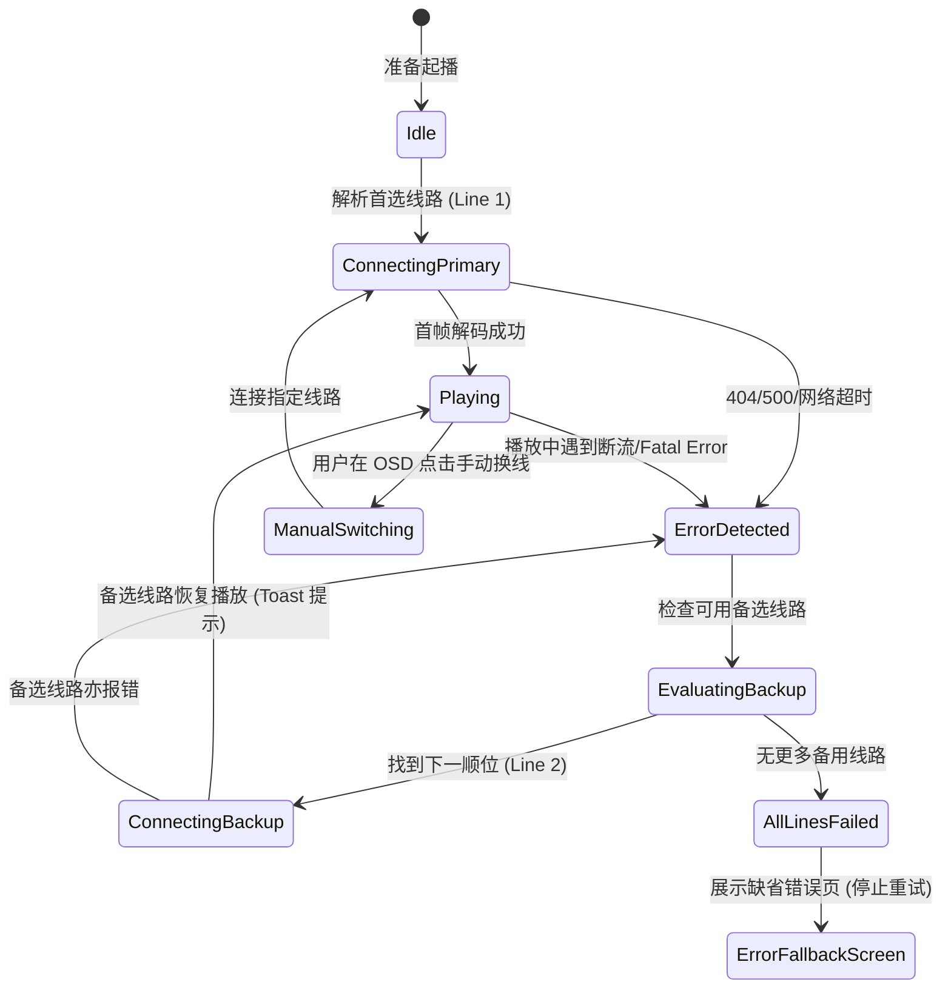
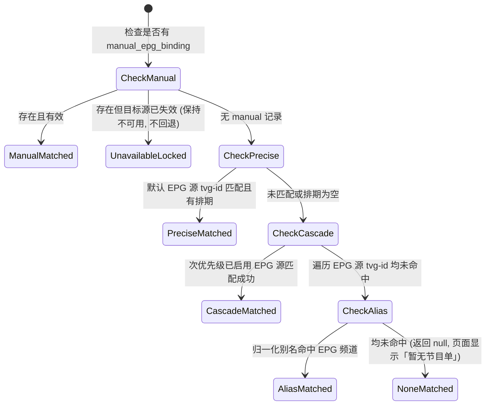

# Data Model: 多直播源聚合与多 EPG 源级联匹配 (016-multi-source-live-epg)

**Feature**: 多直播源聚合与多 EPG 源级联匹配及前端实时呈现  
**Spec Reference**: `docs/specs/016-multi-source-live-epg/spec.md`  
**Governing ADRs**: ADR-0007, ADR-0008, ADR-0010, ADR-0015, ADR-0017

---

## 1. 数据库持久化层变更 (SQLite / Drizzle ORM)

### 1.1 `media_source` 表扩展（新增优先级字段）
为了支持多个 EPG 数据源的级联匹配权重与有序调度，在既有 `media_source` 表增加 `priority` 字段。

```sql
-- Migration: 0010_multi_source_priority
ALTER TABLE media_source ADD COLUMN priority INTEGER NOT NULL DEFAULT 100;

-- 索引：按家庭、源类型与优先级排序检索
CREATE INDEX idx_media_source_household_kind_prio 
ON media_source(household_id, kind, priority ASC);
```

- **语义**：
  - `priority`：数值越小优先级越高（如 10 > 50 > 100）。
  - 默认值为 100，保证既有历史源完全向后兼容。
  - 仅在 `kind = 'epg'` 时参与级联回退裁决；对于 `kind = 'iptv'` 亦可作为默认线路起播权重。

### 1.2 频道别名映射表 `epg_channel_alias`（可选增强持久化）
支持用户或系统为特殊频道定制别名，将 M3U 频道名映射到统一归一化键。

```sql
CREATE TABLE epg_channel_alias (
  id TEXT PRIMARY KEY,
  household_id TEXT NOT NULL REFERENCES household(id) ON DELETE CASCADE,
  normalized_key TEXT NOT NULL,       -- 规范化基准名，如 "cctv1", "zhejiang"
  raw_pattern TEXT NOT NULL,          -- 匹配模式或原名，如 "CCTV-1 综合", "CCTV1HD"
  created_at TEXT NOT NULL DEFAULT (strftime('%Y-%m-%dT%H:%M:%fZ', 'now'))
);

CREATE UNIQUE INDEX uq_epg_alias_household_pattern 
ON epg_channel_alias(household_id, raw_pattern);
```

### 1.3 多直播线路存储映射（多对一解耦）
沿用现有的 `source_entry` 与 `media_item` 关联架构，一个 `media_item`（逻辑频道）可以拥有多个 `source_entry`（物理流条目）：

```
media_item (id: "media_cctv1", type: "channel")
  ├── source_entry (id: "entry_line_1", source_id: "src_telecom", display_title: "CCTV-1 1080P", priority: 10)
  └── source_entry (id: "entry_line_2", source_id: "src_unicom",  display_title: "CCTV-1 4K",    priority: 20)
```

---

## 2. 领域模型与值对象 (Domain Models)

### 2.1 物理流线路（StreamLine）
```typescript
export interface StreamLine {
  readonly lineId: string;           // 线路唯一标识 (对应 source_entry.id)
  readonly sourceId: string;         // 所属 IPTV 来源 ID
  readonly sourceTitle: string;      // 来源显示名称 (如 "电信主源", "移动备用")
  readonly label: string;            // 线路显示标签 (如 "线路 1 [1080P]")
  readonly priority: number;         // 线路排序权重
  readonly isDefault: boolean;       // 是否为首选起播线路
  readonly isEnabled: boolean;       // 是否启用
}
```

### 2.2 逻辑频道与多线路聚合实体（LiveChannelAggregate）
```typescript
export interface LiveChannelAggregate {
  readonly mediaId: string;
  readonly householdId: string;
  readonly canonicalName: string;    // 归一化规范名 (如 "CCTV-1 综合")
  readonly normalizedKey: string;    // 匹配键 (如 "cctv1")
  readonly logoRef: string | null;
  readonly groupTitle: string | null;
  readonly lines: readonly StreamLine[];
  readonly manualBindingId: string | null;
}
```

### 2.3 当前/下一档排期投影（CurrentNextProjection）
```typescript
export interface CurrentNextProjection {
  readonly current: {
    readonly key: string;            // 不透明 SHA-256 节目标识
    readonly title: string;          // 节目标题 (如 "新闻联播")
    readonly start: string;          // ISO-8601 UTC
    readonly end: string;            // ISO-8601 UTC
    readonly progress: number;       // 当前进度 (0.00 ~ 1.00)
  } | null;
  readonly next: {
    readonly key: string;
    readonly title: string;
    readonly start: string;
    readonly end: string;
  } | null;
  readonly epgSourceId: string | null; // 本次命中排期的 EPG 源 ID (用于诊断)
  readonly matchMode: 'manual' | 'precise' | 'cascade' | 'alias' | 'none';
}
```

---

## 3. 状态流转与生命周期 (State Transitions)

### 3.1 播放器线路容灾状态机 (Player Failover State Machine)



### 3.2 EPG 匹配状态流转

