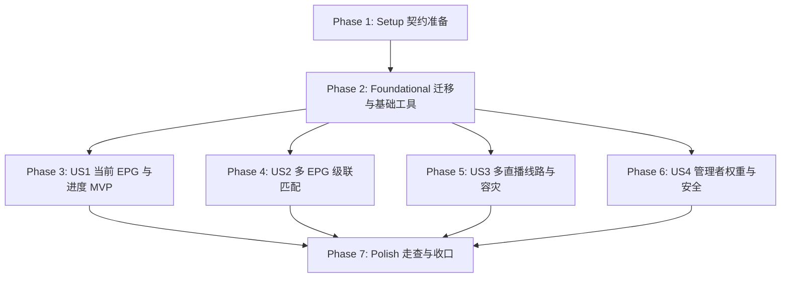

# Tasks: 多直播源聚合与多 EPG 源级联匹配及前端实时呈现 (016-multi-source-live-epg)

**Input**: [spec.md](spec.md)、[plan.md](plan.md)、[research.md](research.md)、[data-model.md](data-model.md)、[contracts/](contracts/)、[quickstart.md](quickstart.md)  
**Prerequisites**: plan.md (required), spec.md (required), research.md, data-model.md, contracts/, quickstart.md  
**Tests**: 项目宪章核心原则一要求多层测试证据（包含单元测试、端到端测试、接口负向测试与走查指南）；所有任务均严格对照规格要求执行。  
**Organization**: 任务按用户故事组织，支持增量交付与独立测试。

## Format: `[ID] [P?] [Story] Description`
- **[P]**: 可并行执行（不同文件、无未完成依赖）
- **[Story]**: 对应规格中的用户故事（US1～US4）
- 每个任务必须包含明确的文件路径

---

## Phase 1: Setup (共享工程基线与契约准备)

**Purpose**: 准备测试基线并定义跨包共享的 DTO 契约类型

- [X] T001 记录现状基线：运行 `pnpm lint`、`pnpm typecheck` 以及 `pnpm --filter @hmp/server test` 确保当前基线全绿
- [X] T002 [P] 扩展共享 DTO 契约：在 `packages/shared/src/experience-schema.d.ts` 与 `packages/shared/src/playback-schema.d.ts` 中声明 `CurrentNextProjection`、`StreamLineDto`、`PlaybackResolveResponseDto` 以及 `EpgSourcePriorityDto`

---

## Phase 2: Foundational (阻塞性基础设施准备)

**Purpose**: 数据库表迁移与多源归一化基础工具（阻塞后续所有用户故事）

**⚠️ CRITICAL**: 在本阶段完成前不得启动后续用户故事的实现

- [X] T003 创建数据表迁移 `0010_multi_source_priority`：在 `apps/server/src/platform/database/migrations/0010_multi_source_priority/` 中添加迁移脚本，为 `media_source` 表增加 `priority INTEGER NOT NULL DEFAULT 100` 列并建立 `(household_id, kind, priority)` 复合索引
- [X] T004 更新数据源 Schema 与持久化端口：在 `apps/server/src/platform/database/schema.ts` 与 `apps/server/src/contexts/sources/application/sources-store.port.ts` 中注册 `priority` 字段映射
- [X] T005 [P] 实现频道名称归一化纯函数：在 `apps/server/src/contexts/live-tv/domain/channel-normalizer.ts` 中实现 `normalizeChannelName`，清除 `4K`、`1080P`、`HEVC`、`IPv6`、`[备份]` 等后缀并编写单测 `apps/server/test/unit/live-tv/channel-normalizer.spec.ts`

**Checkpoint**: 基础迁移与归一化工具就绪，用户故事实施可并行展开。

---

## Phase 3: User Story 1 - 观影者实时查看当前频道节目与精准进度 (Priority: P1) 🎯 MVP

**Goal**: 完整实现前台各频道当前正在播出节目标题、HeroUI `<Progress>` 进度条、下一档预告与智能时钟无感翻转

**Independent Test**: 打开 `/live` 或 `/live/channels`，每个频道卡片立即展示当前节目与进度条；当模拟时间到达节目结束点时，卡片自动切换下一节目且不刷新整页；无 EPG 时显示“暂无节目单”。

### Tests for User Story 1 (REQUIRED) ⚠️
- [X] T006 [P] [US1] 智能时钟 Hook 单元测试：在 `apps/web/test/features/live/use-current-programme.spec.ts` 中使用 fake timers 验证进度百分比计算、精准定时器到期翻转及回调触发
- [X] T007 [P] [US1] 批量当前节目投影接口契约测试：在 `apps/server/test/contract/public-now-playing.e2e-spec.ts` 中验证 `GET /api/public/live/channels/now-playing` 返回当前/下一档节目且零认证拦截

### Implementation for User Story 1
- [X] T008 [US1] 暴露批量当前节目接口：在 `apps/server/src/contexts/live-tv/interface/public-live.controller.ts` 中实现 `GET /api/public/live/channels/now-playing`，复用 `loadLiveChannelWindows` 固定次数查询
- [X] T009 [P] [US1] 封装 `useCurrentProgramme` Hook：在 `apps/web/src/features/live/hooks/use-current-programme.ts` 中实现智能事件定时器与本地 15 秒平滑进度计算
- [X] T010 [US1] 升级频道卡片进度微条：在 `apps/web/src/features/live/components/channel-card.tsx` 中接入 `useCurrentProgramme`，使用 HeroUI `<Progress size="sm" color="primary">` 呈现进度，并处理“暂无节目单”缺省态
- [X] T011 [US1] 一体化播放页信息区联动：在 `apps/web/src/features/live/pages/LiveWatchPage.tsx` 的右侧面板集成当前节目标题、进度条与下一档预告

**Checkpoint**: 此时 User Story 1 具备完整的 MVP 价值，页面即可呈现精准的当前节目与动态进度。

---

## Phase 4: User Story 2 - 多 EPG 源自动级联匹配与手动锁定保护 (Priority: P2)

**Goal**: 实现多 EPG 源的 5 级确定性匹配引擎，支持主源缺失由备用源自动补充，且严格遵循 ADR-0008 手动绑定防覆盖

**Independent Test**: 配置主备两个 EPG 源，主源缺失的频道由备用源成功填充；手动绑定的频道在触发全量 EPG 同步后仍保持原绑定不被覆盖。

### Tests for User Story 2 (REQUIRED) ⚠️
- [X] T012 [P] [US2] 级联 EPG 解析单元测试：在 `apps/server/test/unit/epg/cascading-epg-resolution.spec.ts` 中验证 Manual 优先、tvg-id 匹配、多源优先级级联回退、别名归一化命中及全落空兜底
- [X] T013 [P] [US2] 全量刷新防覆盖集成测试：在 `apps/server/test/contract/multi-epg-sync.e2e-spec.ts` 中验证后台刷新 EPG 时 `manual_epg_binding` 标记记录 100% 保持不变

### Implementation for User Story 2
- [X] T014 [US2] 重构级联解析核心：在 `apps/server/src/contexts/live-tv/application/live-projection.service.ts` 中扩展 `loadLiveChannelWindows`，按 `priority ASC` 级联遍历 Household 下已启用 EPG 源，并执行 `normalizeChannelName` 别名比对，保持 9 次固定 SQL 查询预算
- [X] T015 [US2] 保护 ADR-0008 手动锁定规则：在 `apps/server/src/contexts/epg/application/manual-epg-binding.service.ts` 中确保手动绑定失效时保持 `unavailable`，绝不静默回退自动源

**Checkpoint**: User Story 1 和 2 协同工作，多 EPG 源实现高覆盖率自动化匹配与精准呈现。

---

## Phase 5: User Story 3 - 多直播源（多线路）聚合与播放器自动容灾 (Priority: P3)

**Goal**: 同名频道自动聚合成单频道的多条播放线路，播放器支持断流静默 Failover 与 OSD 手动换线

**Independent Test**: 为频道配置 2 条线路，模拟线路 1 报错 500 时播放器在 3 秒内自动切至线路 2 恢复播放；OSD 菜单支持手动点击切换线路。

### Tests for User Story 3 (REQUIRED) ⚠️
- [X] T016 [P] [US3] 多直播线路聚合单元测试：在 `apps/server/test/unit/catalog/multi-stream-aggregation.spec.ts` 中验证导入多个 M3U 时同名频道自动挂载为多条 `source_entry` 线路
- [X] T017 [P] [US3] 播放解析线路列表契约测试：在 `apps/server/test/contract/playback-lines.e2e-spec.ts` 中验证 `GET /api/playback/channels/:mediaId/resolve` 正确下发 `lines` 数组与 `selectedLineId`

### Implementation for User Story 3
- [X] T018 [US3] 导入管道多流聚合：在 `apps/server/src/contexts/sources/infrastructure/m3u.parser.ts` 与 `catalog-admin.service.ts` 中支持按 `normalizeChannelName` 将同名流聚合成单个 `media_item` 下的多条物理线路
- [X] T019 [US3] 播放解析器下发多线路：在 `apps/server/src/contexts/playback/application/playback-resolver.service.ts` 中扩展解析逻辑，按权重选出默认线路，并下发全部可用线路列表
- [X] T020 [P] [US3] 播放器自动容灾调度：在 `apps/web/src/features/live/components/LiveHeroPlayer.tsx`（及对应播放器容器）中监听致命错误，实现自动递进切换下一线路，并通过 HeroUI Toast 提示换线
- [X] T021 [US3] 播放器 OSD 线路切换菜单：在 `apps/web/src/features/live/components/PlayerLineSwitcher.tsx` 中使用 HeroUI `<Dropdown>` 实现线路列表选择器，并集成到播放控制栏

**Checkpoint**: 用户看电视时即便遇到坏源也能自动自愈或一键切线，播放体验高度可靠。

---

## Phase 6: User Story 4 - 管理者多源权重与渠道管控 (Priority: P4)

**Goal**: 管理者在后台调配 EPG 源优先级权重，管理频道线路开关，严格执行儿童白名单防线

**Independent Test**: 管理者调整 EPG 权重并保存，系统按新权重回退；儿童档案访问未授权频道时无论多少线路均被 403 坚决阻断。

### Tests for User Story 4 (REQUIRED) ⚠️
- [X] T022 [P] [US4] EPG 源权重接口与越权负向测试：在 `apps/server/test/contract/settings-epg-priorities.e2e-spec.ts` 中验证主管理员可读写优先级，非管理员直接返回 403
- [X] T023 [P] [US4] 儿童档案多线路白名单负向测试：在 `apps/server/test/contract/child-profile-multiline-policy.e2e-spec.ts` 中验证儿童档案收看未在 `allowedChannelIds` 中的频道时播放解析器严格拒绝签发 ticket

### Implementation for User Story 4
- [X] T024 [US4] 实现 EPG 源权重接口：在 `apps/server/src/contexts/settings/interface/settings-epg.controller.ts` 中实现 `GET / PUT /api/settings/sources/epg-priorities`，受 `SettingsGuard` 保护
- [X] T025 [P] [US4] 构建 EPG 源权重管理界面：在 `apps/web/src/features/settings/settings-iptv-page.tsx` 中添加 EPG 源优先级拖拽/排序调整组件，使用 HeroUI 列表与按钮

**Checkpoint**: 全链路治理与安全控制闭环。

---

## Phase 7: Polish & Cross-Cutting Concerns (走查与收口)

**Purpose**: 全量回归、端到端走查与文档一致性同步

- [X] T026 [P] 编写端到端走查脚本：在 `apps/web/test/e2e/multi-source-live-epg.spec.ts` 中覆盖 `quickstart.md` 所列的 5 个端到端核心场景
- [X] T027 [P] 更新领域模型基线文档：在 `homeMediaDomainModel.md` 中记录多流物理线路（StreamLine）解耦与多 EPG 源级联裁决规则
- [X] T028 全量门禁核验：运行 `pnpm lint`、`pnpm typecheck` 以及全部自动化测试，确保 100% 全绿且零警告

---

## Dependencies & Execution Order

### Phase Dependencies

### User Story Execution Strategy

1. **MVP 优先 (Phase 1 + 2 + 3)**：
   - 先行完成共享契约、基础迁移与 Phase 3（US1）；
   - **立即交付并验证**：前端卡片已能展示当前节目、进度条及平滑翻转，实现核心可用版本！
2. **渐进增强 (Phase 4 & Phase 5)**：
   - 接入多 EPG 级联算法，大幅提升匹配命中率（US2）；
   - 接入多直播源聚合与自动容灾换线（US3）；
3. **治理收口 (Phase 6 & Phase 7)**：
   - 接入管理者权重排序与儿童白名单安全验证（US4），执行端到端全量走查。

---

## Parallel Opportunities

- **Phase 1**: T001 与 T002 可并行；
- **Phase 2**: T004 与 T005 可并行；
- **Phase 3 (US1)**: 测试 T006/T007、前端 Hook T009 可并行执行；
- **Phase 4 (US2)**: 单元测试 T012、契约测试 T013 可与解析开发并行（TDD）；
- **Phase 5 (US3)**: 测试 T016/T017、前端容灾 T020 可并行执行；
- **Phase 6 (US4)**: 负向测试 T022/T023 与前端组件 T025 可并行执行。
