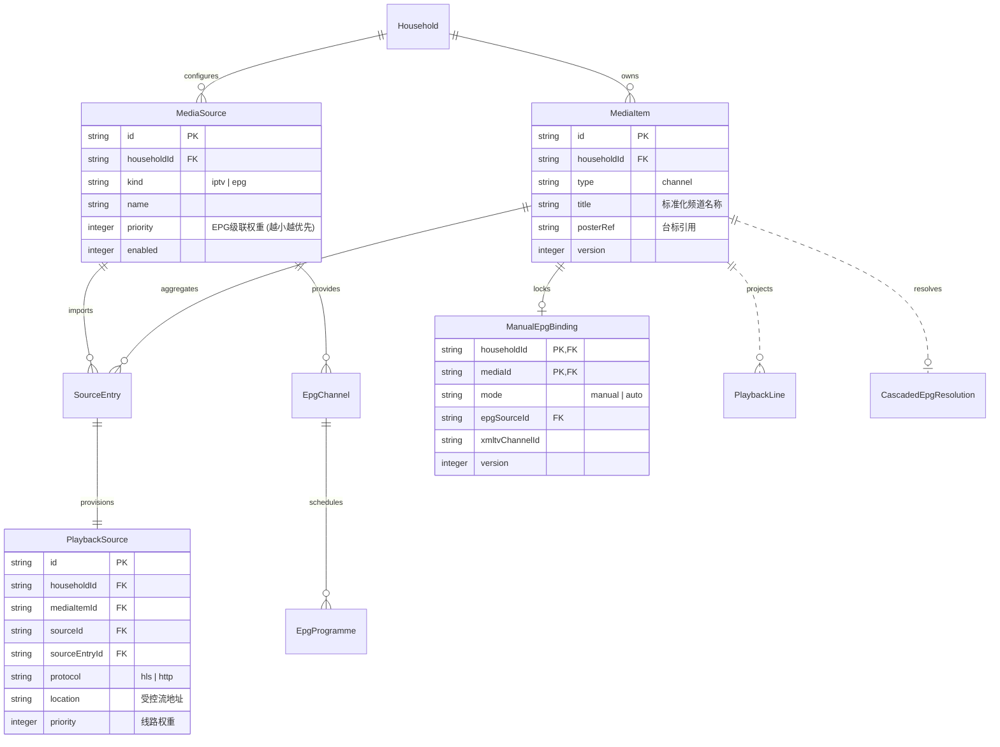

# Data Model: 频道中心制与物理流/EPG源彻底解耦架构

**Feature**: `017-channel-centric-architecture`
**Created**: 2026-11-09
**Status**: Ready

---

## 1. 实体关系总览 (Entity-Relationship Overview)



---

## 2. 核心实体与属性定义 (Entities & Attributes)

### 2.1 逻辑频道 (Logical Channel: `media_item`, type='channel')
- **职责**：平台顶层直播资产实体，上层业务（节目单、大厅展示、播放器、收藏夹、权限策略）唯一交互主体。
- **持久化表**：`media_item`
- **关键字段**：
  - `id`: 频道全局唯一标识符（UUID）。
  - `household_id`: 所属家庭边界（不可妥协）。
  - `type`: 固定为 `'channel'`。
  - `title`: 频道的清洗后标准名称（如 `"CCTV-1 综合"`）。
  - `poster_ref`: 频道台标（Logo）资源引用。
  - `content_level`: 内容分级（0-18），由管理员配置或导入解析，受 `ProfilePolicy` 管制。

### 2.2 播放线路 (Playback Line: `playback_source` / `source_entry`)
- **职责**：物理流传输层的抽象，单逻辑频道聚合多条播放线路（1:N）。
- **持久化表**：`playback_source` 关联 `source_entry`
- **只读投影字段 (StreamLine Projection)**：
  - `lineId`: 线路唯一标识符（即 `playback_source.id`）。
  - `label`: 线路展示标签（例如 `"线路 1 · 1080P"`、`"线路 2 · 4K (电信)"`、`"线路 3 · 备用"`）。由来源名称与清晰度差异段清洗自动派生。
  - `protocol`: 流协议类型（`hls`, `dash`, `http`）。
  - `priority`: 综合优先级权重（`media_source.priority` + 清晰度奖励分）。
  - `isDefault`: 是否为该频道的首选默认播放线路（优先级最高且连通正常）。
  - `isEnabled`: 是否启用。

### 2.3 EPG 节目单资源池 (EPG Schedule Pool: `epg_channel`, `epg_programme`)
- **职责**：按时间窗口存储各 EPG 源同步解析出的节目排期，供逻辑频道级联查询。
- **持久化表**：`epg_channel`, `epg_programme`
- **关键字段**：
  - `epg_channel.source_id`: 所属 EPG 来源标识符。
  - `epg_channel.xmltv_channel_id`: XMLTV 频道标识（如 `"CCTV1"`）。
  - `epg_channel.display_name`: 频道显示名称。
  - `epg_programme.title`: 节目标题。
  - `epg_programme.start_time`: ISO-8601 UTC 开始时间。
  - `epg_programme.end_time`: ISO-8601 UTC 结束时间。

### 2.4 频道 EPG 绑定记录 (Channel EPG Binding: `manual_epg_binding`)
- **职责**：记录管理员对该频道的显式锁定规则（ADR-0008）。
- **持久化表**：`manual_epg_binding`
- **状态转移规则**：
  - `mode = 'manual'`: `epg_source_id` 与 `xmltv_channel_id` 均必须非空。保存后立即锁定，级联判定直接命中 Level 1。
  - `mode = 'auto'`: `epg_source_id` 与 `xmltv_channel_id` 必须为 `NULL`。作为解除锁定后的版本墓碑行，系统恢复自动级联（Level 2 ~ Level 4）。

---

## 3. 业务读投影 (Read Projections)

### 3.1 客户端直播大厅与节目单投影 (`LiveChannelProjection`)
```typescript
export interface LiveChannelProjection {
  channelId: string;
  name: string;
  logoUrl: string | null;
  category: string;
  // 多线路聚合概要
  lineCount: number;
  defaultLineId: string;
  // 级联 EPG 决策结果
  matchMode: 'manual' | 'precise' | 'cascade' | 'alias' | 'none';
  epgSourceId: string | null;
  epgSourceName?: string;
  // 当前正在播放与下一个节目
  currentProgramme: {
    title: string;
    start: string; // ISO-8601 UTC
    end: string;   // ISO-8601 UTC
    progress: number; // 0.0 - 1.0 (客户端时钟自驱动更新)
  } | null;
  nextProgramme: {
    title: string;
    start: string;
    end: string;
  } | null;
}
```

### 3.2 管理后台频道资产工作台投影 (`AdminChannelWorkbenchItem`)
```typescript
export interface AdminChannelWorkbenchItem {
  channelId: string;
  title: string;
  logoUrl: string | null;
  category: string;
  contentLevel: number | null;
  // 线路聚合详情
  lines: Array<{
    lineId: string;
    sourceId: string;
    sourceName: string;
    label: string;
    priority: number;
    protocol: string;
  }>;
  // 当前 EPG 匹配状态
  binding: {
    mode: 'manual' | 'auto';
    isLocked: boolean;
    epgSourceId: string | null;
    epgSourceName: string | null;
    xmltvChannelId: string | null;
    epgChannelDisplayName: string | null;
    effectiveMatchMode: 'manual' | 'precise' | 'cascade' | 'alias' | 'none';
    programmeCountToday: number;
  };
}
```
