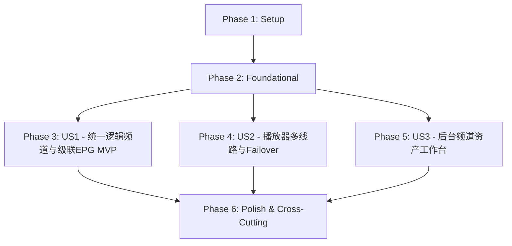

# Tasks: 频道中心制与物理流/EPG源彻底解耦架构 (Channel-Centric Architecture)

**Input**: Design documents from `/docs/specs/017-channel-centric-architecture/` (`plan.md`, `spec.md`, `research.md`, `data-model.md`, `contracts/`, `quickstart.md`)

**Prerequisites**: Follow `.specify/memory/constitution.md` (Principle VII Channel-Centric Abstraction, Principle I-VI, HeroUI v3 & Lucide icons).

**Tests**: Required by project constitution. Each user story includes unit/contract tests, negative/tampering authorization tests, and runtime verification.

**Organization**: Tasks are grouped by user story to enable independent implementation and testing of each story.

---

## Format: `[ID] [P?] [Story] Description with exact file path`

- **[P]**: Can run in parallel (different files, no dependencies)
- **[Story]**: Which user story this task belongs to (US1, US2, US3)
- Include exact file paths in descriptions

---

## Phase 1: Setup (Shared Infrastructure)

**Purpose**: Shared types, contracts and test harness initialization

- [x] T001 [P] Review and refine shared contract definitions for Logical Channel, StreamLine, and EPG cascade in `packages/shared/src/catalog-schema.d.ts` and `packages/shared/src/index.ts`
- [x] T002 [P] Define Admin Channel Workbench DTOs in `packages/shared/src/settings-schema.d.ts` and export through `packages/shared/src/index.ts`
- [x] T003 [P] Verify environment and database test rigs in `apps/server/test/fixtures/controlled-media-server.ts`

---

## Phase 2: Foundational (Blocking Prerequisites)

**Purpose**: Core domain model alignment and multi-stream aggregation foundation

**⚠️ CRITICAL**: No user story work can begin until this phase is complete

- [x] T004 [P] Ensure DDL and entity mappings for `media_item` (channel) and `playback_source` (lines) in `apps/server/src/platform/database/schema.ts`
- [x] T005 [P] Validate multi-stream aggregation and line priority calculations in `apps/server/src/contexts/sources/infrastructure/m3u.parser.ts`
- [x] T006 Ensure refresh & publish transactions correctly merge same-named streams into single `media_item` with multiple `playback_source` entries in `apps/server/src/contexts/sources/application/refresh-publish.service.ts`
- [x] T007 [P] Verify multi-stream aggregation unit tests in `apps/server/test/unit/catalog/multi-stream-aggregation.spec.ts`

**Checkpoint**: Foundation ready - logical channels correctly aggregate multiple physical stream lines.

---

## Phase 3: User Story 1 - 统一逻辑频道消费与级联 EPG 节目单展示 (Priority: P1) 🎯 MVP

**Goal**: 观看者在直播大厅与节目单中消费统一逻辑频道，系统基于五级级联阶梯聚合多 EPG 源，实时计算出当前节目与时钟进度条。

**Independent Test**: 导入包含同名频道的多个 M3U 源与多个 XMLTV EPG 源，访问直播大厅，验证无重复频道，且首屏 200ms 内准确呈现当前/下一节目标题与进度条。

### Tests for User Story 1 (REQUIRED) ⚠️

- [x] T008 [P] [US1] Unit test for five-level cascading EPG resolution in `apps/server/test/unit/epg/cascading-epg-resolution.spec.ts`
- [x] T009 [P] [US1] Integration contract test for public live channels with cascaded EPG in `apps/server/test/contract/public-now-playing.e2e-spec.ts`
- [x] T010 [P] [US1] Component test for live EPG clock and progress calculation in `apps/web/test/features/live/use-current-programme.spec.ts`

### Implementation for User Story 1

- [x] T011 [US1] Implement multi-EPG cascading resolution algorithm (L1 Manual -> L2 Precise -> L3 Priority Cascade -> L4 Alias -> L5 Fallback) in `apps/server/src/contexts/live-tv/application/live-projection.service.ts`
- [x] T012 [US1] Expose deduplicated logical channels with current/next programme in `apps/server/src/contexts/live-tv/interface/live.controller.ts`
- [x] T013 [P] [US1] Connect real-time progress clock hook for channel card and schedule strips in `apps/web/src/features/live/hooks/use-current-programme.ts`
- [x] T014 [US1] Render channel card with clean title, logo, and active programme timeline in `apps/web/src/features/live/components/CategorySwimlanes.tsx`

**Checkpoint**: User Story 1 (MVP) is fully functional and testable independently.

---

## Phase 4: User Story 2 - 播放器多线路切换与断流自动容灾 (Priority: P2)

**Goal**: 播放器加载逻辑频道时获取聚合的多条物理线路，提供手动线路切换面板，并在流媒体中断时由协调器在 5 秒内自动切换至健康备用线路。

**Independent Test**: 点击播放具有多条线路的频道，手动切换线路可立即切流；模拟正在播放的线路网络中断，播放器 5 秒内自动连接第二线路恢复播放并给出友好 Toast 提示。

### Tests for User Story 2 (REQUIRED) ⚠️

- [x] T015 [P] [US2] Contract test for playback resolve with streamLines list in `apps/server/test/contract/playback-lines.e2e-spec.ts`
- [x] T016 [P] [US2] Component test for PlayerLineSwitcher UI and line selection in `apps/web/test/features/live/player-line-switcher.spec.tsx`
- [x] T017 [P] [US2] Failover simulation test for PlaybackFailoverCoordinator under network error in `apps/web/test/features/live/playback-failover.spec.tsx`

### Implementation for User Story 2

- [x] T018 [US2] Build ordered stream lines projection with line labels and priority in `apps/server/src/contexts/playback/application/playback-resolver.service.ts`
- [x] T019 [US2] Implement playback resolve endpoint returning streamLines and active ticket in `apps/server/src/contexts/playback/interface/playback.controller.ts`
- [x] T020 [P] [US2] Implement HeroUI-compliant line switcher panel in `apps/web/src/features/live/components/PlayerLineSwitcher.tsx`
- [x] T021 [US2] Implement automatic failover retry and backup line switching coordinator in `apps/web/src/features/live/components/LiveHeroPlayer.tsx`

**Checkpoint**: User Stories 1 AND 2 both work independently and integrate seamlessly.

---

## Phase 5: User Story 3 - 管理后台频道资产工作台与跨源 EPG 绑定 (Priority: P3)

**Goal**: 彻底移除旧有怪异的“直播源 1:1 关联 EPG 源”界面，建立以逻辑频道资产为中心的管理工作台（Channel Workbench），支持查看线路汇聚数量并在 Modal 中跨任意 EPG 源检索绑定。

**Independent Test**: 进入后台 IPTV 管理，进入“频道资产”标签，主表清晰展示频道、线路数 Chip 与 EPG 绑定状态；点击“绑定 EPG”打开 Modal，自由切换不同 EPG 源并搜索候选，保存后即刻生效为手动锁定模式。

### Tests for User Story 3 (REQUIRED) ⚠️

- [x] T022 [P] [US3] Contract test for channel candidate query with line counts and EPG match info in `apps/server/test/contract/catalog-candidates.e2e-spec.ts`
- [x] T023 [P] [US3] Contract test for manual EPG binding lock and clear across any EPG source in `apps/server/test/contract/manual-epg-binding.e2e-spec.ts`
- [x] T024 [P] [US3] UI test for Channel Asset Workbench and EPG binding modal in `apps/web/test/settings/settings-epg-page.spec.tsx`

### Implementation for User Story 3

- [x] T025 [US3] Implement channel candidates query returning line count badges and EPG match details in `apps/server/src/contexts/media-catalog/application/catalog-admin.service.ts`
- [x] T026 [US3] Expose cross-source EPG candidate query and manual binding endpoints in `apps/server/src/contexts/settings/interface/settings-epg.controller.ts`
- [x] T027 [US3] Remove residual "直播来源关联 (Live Source Association)" section from `apps/web/src/features/settings/settings-epg-page.tsx`
- [x] T028 [US3] Refactor SettingsEpgPage into Channel Asset Workbench (table displaying channel logo, name, line counts chip, and EPG match status) in `apps/web/src/features/settings/settings-epg-page.tsx`
- [x] T029 [US3] Implement HeroUI Modal for multi-source EPG candidate search and locking in `apps/web/src/features/settings/settings-epg-page.tsx`
- [x] T030 [US3] Update SettingsIptvPage tabs naming and structure to highlight the Channel Workbench in `apps/web/src/features/settings/settings-iptv-page.tsx`

**Checkpoint**: All 3 user stories are independently functional, verifiable, and adhere to Principle VII.

---

## Phase 6: Polish & Cross-Cutting Concerns

**Purpose**: End-to-end verification and quality gate validation

- [x] T031 [P] Run all unit and integration test suites (`pnpm --filter @hmp/server test` and `pnpm --filter @hmp/web test`)
- [x] T032 [P] Execute full-workspace typecheck (`pnpm typecheck`)
- [x] T033 Execute end-to-end quickstart validation scenarios defined in `docs/specs/017-channel-centric-architecture/quickstart.md`
- [x] T034 [P] Update documentation and link accepted spec/plan in `docs/specs/017-channel-centric-architecture/`

---

## Dependencies & Execution Order

### Phase Dependencies

- **Setup (Phase 1)**: Can start immediately.
- **Foundational (Phase 2)**: Depends on Setup. Blocks all User Stories.
- **User Stories (Phase 3, 4, 5)**:
  - Can be executed sequentially: P1 (US1) -> P2 (US2) -> P3 (US3);
  - Or in parallel across independent developers once Phase 2 is complete.
- **Polish (Phase 6)**: Runs after all user stories complete.

---

## Parallel Opportunities

- **Phase 1**: T001, T002, T003 can run in parallel (different packages/files).
- **Phase 2**: T004, T005, T007 can run in parallel.
- **User Story 1**: T008, T009, T010 tests can run in parallel before implementation.
- **User Story 2**: T015, T016, T017 tests can run in parallel before implementation.
- **User Story 3**: T022, T023, T024 tests can run in parallel before implementation.
- **Cross-Story**: Once Phase 2 is complete, US1, US2, and US3 can proceed in parallel.

---

## Implementation Strategy

### MVP First (User Story 1 Only)
1. Complete Phase 1: Setup contracts.
2. Complete Phase 2: Foundational multi-stream aggregation.
3. Complete Phase 3: User Story 1 (Cascading EPG + Logical Channel Live TV presentation).
4. **STOP & VALIDATE**: Verify that viewers see clean, deduplicated channels with real-time EPG progress.

### Incremental Delivery
1. Foundation + US1 = MVP Live Experience.
2. Add US2 = Enhanced Reliability with Multi-Line Playback & Failover.
3. Add US3 = Seamless Administration with Channel Asset Workbench & Cross-Source EPG Modal.
4. Polish = Full test suite passing + typecheck clean.
