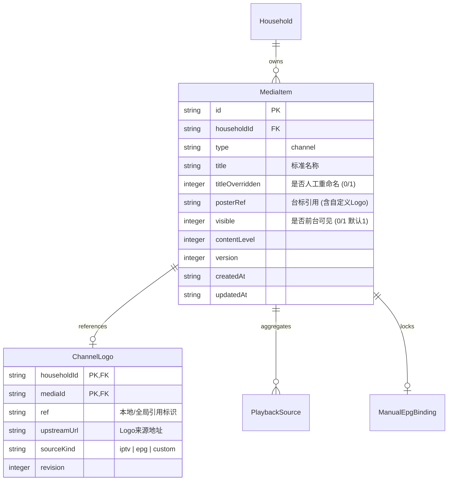

# Data Model: 逻辑频道显隐控制与名称台标自定义编辑

**Feature**: `018-channel-customization`
**Created**: 2026-11-09
**Status**: Ready

---

## 1. 实体关系与字段演进 (Entity Evolution)



---

## 2. 核心字段与状态定义 (Core Fields & Rules)

### 2.1 `media_item` 实体增强 (Logical Channel)
- **`visible` (整型, 0 或 1, 默认 1)**:
  - `visible = 1`: 频道为前台发布/可见状态。在具备有效流的前提下，正常进入前台直播大厅（`/live`）和节目指南（`/guide`）；
  - `visible = 0`: 频道为已隐藏状态。前台公共列表接口（`GET /public/live/channels`、`GET /public/live/groups`）直接过滤排除，终端用户不可见且不可选；后台“频道资产工作台”全量展示所有状态的频道，并在行内提供显隐 Switch 随时切换。
  - **DDL 约束**: `CHECK(visible IN (0, 1))`。
- **`title` 与 `title_overridden`**:
  - `title_overridden = 0`: 原始导入名称，M3U 刷新时若上游名称变更则跟随更新；
  - `title_overridden = 1`: 管理员人工重命名锁定。M3U 刷新发布事务自动跳过该频道的标题更新，永久保护管理员的命名成果。
- **`poster_ref` 与自定义台标**:
  - 存储该频道当前生效的台标图片引用（URL 或本地缓存路径）；
  - 管理员在编辑弹窗指定新 Logo URL 后，写入 `poster_ref`，同时更新 `channel_logo` 记录（标记 `source_kind = 'custom'`），在外部源刷新时享受防覆盖保护。

---

## 3. 契约 DTO 增强 (Contract DTO Extensions)

### 3.1 频道工作台候选投影 (`CandidateDto` / `ChannelWorkbenchItem`)
```typescript
export interface CandidateDto {
  id: string;
  type: 'channel' | 'movie' | 'series' | 'episode' | 'video';
  title: string;
  description: string | null;
  contentLevel: number | null;
  poster: string | null;
  version: number;
  available: boolean;
  // 017 增补
  lineCount?: number;
  epgBinding?: EpgBindingDto;
  // 018 增补: 显隐与台标自定义
  visible: boolean;
  logoUrl?: string | null;
}
```

### 3.2 频道元数据更新请求体 (`PatchMediaRequest`)
```typescript
export interface PatchMediaRequest {
  expectedVersion: number;
  title?: string;
  visible?: boolean;
  logoUrl?: string | null;
  contentLevel?: number | null;
}
```
- **校验规则**:
  - `expectedVersion`: 必填整数，用于乐观并发锁校验；
  - `title`: 可选，长度 1~255 字符，trim 后非空；
  - `visible`: 可选布尔值（`true` 或 `false`）；
  - `logoUrl`: 可选 URL 字符串（支持 HTTP/HTTPS 链接）或 `null`（恢复默认）。
