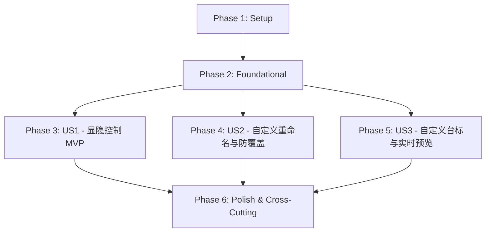

# Tasks: 逻辑频道显隐控制与名称台标自定义编辑 (Channel Visibility & Metadata Customization)

**Input**: Design documents from `/docs/specs/018-channel-customization/` (`plan.md`, `spec.md`, `research.md`, `data-model.md`, `contracts/`, `quickstart.md`)

**Prerequisites**: Follow `.specify/memory/constitution.md` (Principle VII Channel-Centric Abstraction, Principle I-VI, HeroUI v3 & Lucide icons).

**Tests**: Required by project constitution. Each user story includes unit/contract tests, negative/tampering authorization tests, and runtime verification.

**Organization**: Tasks are grouped by user story to enable independent implementation and testing of each story.

---

## Format: `[ID] [P?] [Story] Description with exact file path`

- **[P]**: Can run in parallel (different files, no dependencies)
- **[Story]**: Which user story this task belongs to (US1, US2, US3)
- Include exact file paths in descriptions

---

## Phase 1: Setup (Shared Infrastructure)

**Purpose**: Shared types, DTO contracts and database migration preparation

- [x] T001 [P] Update `Candidate` and `PatchMediaRequest` schemas in `packages/shared/src/catalog-schema.d.ts` and export through `packages/shared/src/index.ts`
- [x] T002 [P] Rebuild shared package with `export PATH=$PATH:/opt/homebrew/bin; pnpm --filter @hmp/shared build`
- [x] T003 [P] Create DDL migration for `visible` column in `apps/server/src/platform/database/migrations/0011_channel_visibility/up.sql`

---

## Phase 2: Foundational (Blocking Prerequisites)

**Purpose**: Database schema enhancement and availability query filtering

**⚠️ CRITICAL**: No user story work can begin until this phase is complete

- [x] T004 [P] Update `mediaItem` in `apps/server/src/platform/database/schema.ts` to include `visible: integer('visible').notNull().default(1)`
- [x] T005 Update `loadAvailableMediaIdSet` in `apps/server/src/contexts/policy/infrastructure/policy-store.drizzle.ts` to filter `AND mi.visible = 1`
- [x] T006 [P] Update media catalog store methods to persist and retrieve `visible` in `apps/server/src/contexts/media-catalog/infrastructure/media-catalog-store.drizzle.ts`
- [x] T007 [P] Create migration test for `0011_channel_visibility` in `apps/server/test/unit/migration-0011.spec.ts`

**Checkpoint**: Foundation ready - channels have a persistent `visible` flag, and availability queries respect `visible = 1`.

---

## Phase 3: User Story 1 - 频道显隐控制与公共过滤 (Priority: P1) 🎯 MVP

**Goal**: 管理员可在频道资产工作台中一键切换逻辑频道的显示/隐藏状态，前台直播大厅与节目指南自动排除隐藏频道。

**Independent Test**: 在工作台中将某个频道切换为隐藏，调用公开 `/public/live/channels` 接口验证该频道已被排除；切换回显示后即刻恢复。

### Tests for User Story 1 (REQUIRED) ⚠️

- [x] T008 [P] [US1] Contract test for channel visibility toggle and public filtering in `apps/server/test/contract/channel-visibility.e2e-spec.ts`
- [x] T009 [P] [US1] Component test for HeroUI Switch toggle in Channel Workbench in `apps/web/test/settings/channel-visibility-switch.spec.tsx`

### Implementation for User Story 1

- [x] T010 [US1] Support `visible` in `patchMediaMetadata` in `apps/server/src/contexts/media-catalog/application/catalog-admin.service.ts`
- [x] T011 [US1] Update `queryCandidates` in `apps/server/src/contexts/media-catalog/application/catalog-admin.service.ts` to populate `candidate.visible`
- [x] T012 [P] [US1] Integrate HeroUI `Switch` into Channel Workbench rows in `apps/web/src/features/settings/settings-epg-page.tsx`
- [x] T013 [US1] Verify public `/live/channels` and `/live/groups` exclude `visible = 0` channels in `apps/server/src/contexts/live-tv/application/live-projection.service.ts`

**Checkpoint**: User Story 1 (MVP) is fully functional and testable independently.

---

## Phase 4: User Story 2 - 频道名称自定义与防刷新覆盖保护 (Priority: P2)

**Goal**: 管理员可在频道编辑弹窗中自定义修改频道名称，系统标记 `title_overridden = 1`，后续 M3U 刷新同步绝不覆盖人工命名。

**Independent Test**: 修改频道名称为自定义名称并保存；触发 M3U 源重新拉取，验证频道名称保持管理员修改的值不变。

### Tests for User Story 2 (REQUIRED) ⚠️

- [x] T014 [P] [US2] Contract test for channel rename and M3U refresh overwrite protection in `apps/server/test/contract/channel-rename-protection.e2e-spec.ts`
- [x] T015 [P] [US2] Component test for Channel Edit Modal rename form in `apps/web/test/settings/channel-edit-modal.spec.tsx`

### Implementation for User Story 2

- [x] T016 [US2] Ensure `refresh-publish.service.ts` strictly preserves `title` when `title_overridden = 1` in `apps/server/src/contexts/sources/application/refresh-publish.service.ts`
- [x] T017 [US2] Create HeroUI `ChannelEditModal` component with title editing in `apps/web/src/features/settings/components/ChannelEditModal.tsx`
- [x] T018 [US2] Wire "编辑" button in Channel Workbench to open `ChannelEditModal` and mutate via `PATCH /settings/catalog/media/{id}` in `apps/web/src/features/settings/settings-epg-page.tsx`

**Checkpoint**: User Stories 1 AND 2 both work independently and integrate seamlessly.

---

## Phase 5: User Story 3 - 频道自定义台标 Logo 与即时视觉预览 (Priority: P3)

**Goal**: 管理员可在频道编辑弹窗中填入自定义 Logo URL，右侧即时呈现图片预览；保存后锁定为自定义台标，不受外部源刷新冲刷。

**Independent Test**: 在编辑弹窗中输入图片 URL，右侧即时加载台标预览；保存后访问直播大厅，验证该频道卡片成功显示自定义台标。

### Tests for User Story 3 (REQUIRED) ⚠️

- [x] T019 [P] [US3] Contract test for custom logo update and M3U refresh preservation in `apps/server/test/contract/channel-custom-logo.e2e-spec.ts`
- [x] T020 [P] [US3] Component test for real-time Logo URL live preview and fallback in `apps/web/test/settings/channel-logo-preview.spec.tsx`

### Implementation for User Story 3

- [x] T021 [US3] Handle `logoUrl` in `patchMediaMetadata` updating `poster_ref` and `channel_logo` in `apps/server/src/contexts/media-catalog/application/catalog-admin.service.ts`
- [x] T022 [US3] Protect custom logo from being overwritten during M3U/XMLTV refresh in `apps/server/src/contexts/sources/application/refresh-publish.service.ts`
- [x] T023 [P] [US3] Add Logo URL input field with live image preview and error fallback to `apps/web/src/features/settings/components/ChannelEditModal.tsx`
- [x] T024 [US3] Ensure public channels and player reflect custom `logoUrl` immediately upon save

**Checkpoint**: All 3 user stories are independently functional, verifiable, and adhere to Principle VII.

---

## Phase 6: Polish & Cross-Cutting Concerns

**Purpose**: End-to-end verification and quality gate validation

- [x] T025 [P] Run full server test suite (`pnpm --filter @hmp/server test`)
- [x] T026 [P] Run full web test suite (`pnpm --filter @hmp/web test`)
- [x] T027 [P] Run full monorepo typecheck (`pnpm typecheck`)
- [x] T028 Execute end-to-end quickstart scenarios in `docs/specs/018-channel-customization/quickstart.md`

---

## Dependencies & Execution Order

### Phase Dependencies

- **Setup (Phase 1)**: Can start immediately.
- **Foundational (Phase 2)**: Depends on Setup. Blocks all User Stories.
- **User Stories (Phase 3, 4, 5)**:
  - Can proceed in parallel once Phase 2 is complete.
- **Polish (Phase 6)**: Runs after all user stories complete.

---

## Implementation Strategy

### MVP First (User Story 1 Only)
1. Complete Phase 1: Setup DDL & schemas.
2. Complete Phase 2: Foundational database & policy filtering.
3. Complete Phase 3: User Story 1 (Visibility Switch + Live filtering).
4. **STOP & VALIDATE**: Verify that viewers no longer see hidden channels in the live page!

### Incremental Delivery
1. Foundation + US1 = Clean, curated live channel list (MVP!).
2. Add US2 = Standardized channel naming with overwrite protection.
3. Add US3 = High-definition custom logos with live preview.
4. Polish = Full test suite passing + typecheck clean.
